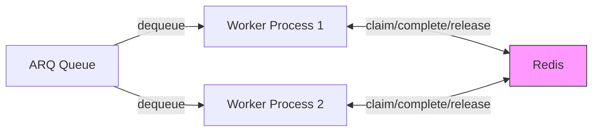
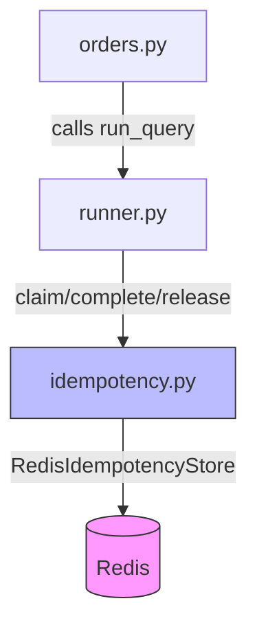
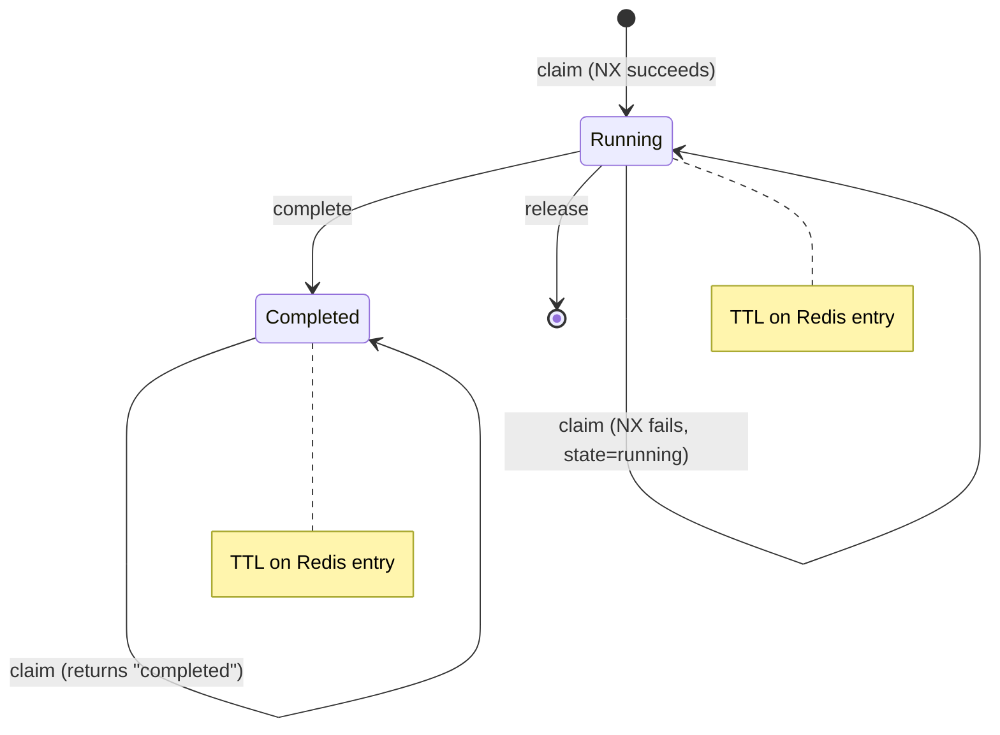
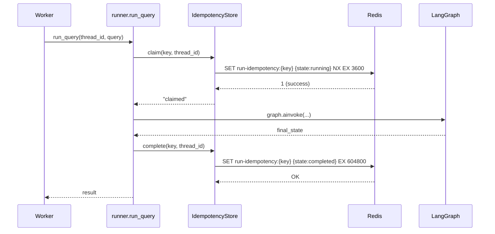
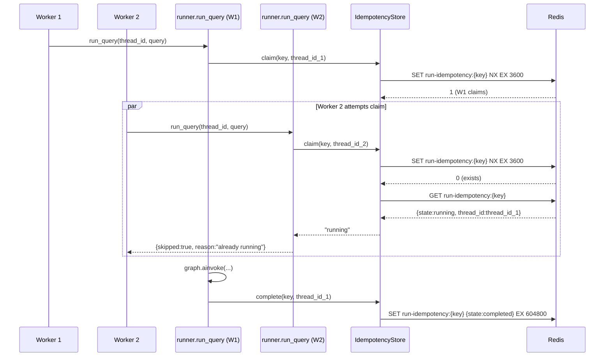
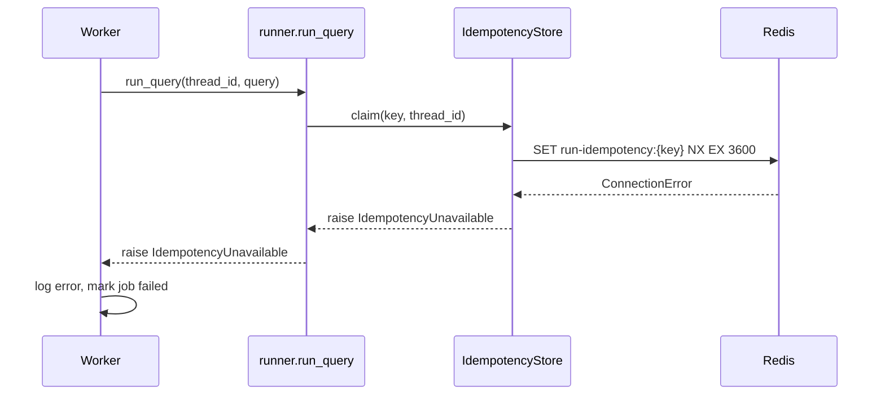

# High-Level Design — PER-101

**Type:** Story  
**Parent:** (none)  
**Title:** Make run idempotency durable across workers with a shared Redis store  
**Status:** Draft

---

## Overview

This design replaces the in-memory `_seen: set[str]` in `src/agents/runtime/idempotency.py` with a durable, Redis-backed store that guarantees at-most-once execution of run keys across worker restarts and processes. The contract binds three operations—`claim`, `complete`, `release`—to a shared Redis key namespace, with an in-memory fallback for local development. The runner (`src/agents/runtime/runner.py`) claims before starting the graph and releases on pause/failure/cancellation. The worker (`src/agents/queue/orders.py`) skips status writes when another worker owns the run. Redis failures during `claim` fail fast; failures during `complete` or `release` log errors but preserve the run result, relying on TTL cleanup.

---

## System Context



**Invariant:** All workers share a single Redis instance (or cluster) as the source of truth for run state. The idempotency key namespace `run-idempotency:*` is owned by this subsystem; no other component writes to it.

---

## Dependencies

**Redis Client:** `redis.asyncio.Redis` from the `redis>=5.0.0` Python package (via `pyproject.toml`). This async client provides the atomic operations required for the claim contract.

**Existing Infrastructure:** `arq` (async Redis queue, already in use), `REDIS_URL` (already in `.env.example`).

---

## Architecture Decisions

### AD-1: Store Abstraction

**Binds:** Two implementations behind a common async interface: `MemoryIdempotencyStore` and `RedisIdempotencyStore`.

**Prevents:** Divergent semantics between local dev (memory) and production (Redis). Different claim/complete/release contracts in the two stores.

**Rule:** The interface is:

```python
class IdempotencyStore(Protocol):
    async def claim(self, key: str, thread_id: str) -> Literal["claimed", "running", "completed"]
    async def complete(self, key: str, thread_id: str) -> None
    async def release(self, key: str, thread_id: str) -> None
```

All stores must implement identical state transition semantics:

- `claim` on a non-existent key → `"claimed"` (creates entry with state `running`)
- `claim` on a `running` entry → `"running"` (no-op)
- `claim` on a `completed` entry → `"completed"` (no-op)
- `release` on a `running` entry → deletes entry (allows re-claim)
- `complete` on a `running` entry → transitions to `completed` state

The memory store uses a dict; the Redis store uses Redis keys. Both must be safe under concurrent access (memory store uses `asyncio.Lock`, Redis store uses atomic Redis operations).

**[ADOPTED]** — The existing codebase already uses `arq` for Redis, and the ticket specifies the interface.

---

### AD-2: Redis Key Contract

**Binds:** Key format, value schema, TTLs, and atomicity guarantees.

**Prevents:** Key collisions with other subsystems. Divergent TTL choices. Non-atomic claim operations allowing double-execution.

**Rule:**

- **Key:** `run-idempotency:{idempotency_key}` where `idempotency_key` is the output of `idempotency_key(task)` (unchanged).
- **Value:** JSON `{"state": "running" | "completed", "thread_id": "<uuid>", "claimed_at": "<iso8601>"}`
  - `claimed_at` is included for observability (not load-bearing for correctness).
- **Claim atomicity:** `SET run-idempotency:{key} <value> NX EX {ttl}`. Returns 1 (claimed), 0 (already exists → check state).
- **Claim TTL:** `IDEMPOTENCY_CLAIM_TTL_SECONDS` (default 3600). Expires stale claims from crashed workers.
- **Completed TTL:** `IDEMPOTENCY_COMPLETED_TTL_SECONDS` (default 604800). Expires old completed runs to bound memory.

The claim operation reads the existing value when SET NX fails, returning `"running"` or `"completed"` based on `state`. The completion operation is `SET run-idempotency:{key} <value> EX {completed_ttl}` (overwrites, not conditional—idempotent). The release operation is `DEL run-idempotency:{key}`.

**[ADOPTED]** — Matches the ticket's specified contract and existing `STATUS_TTL_SECONDS` / `ORDER_JOB_TIMEOUT` values.

---

### AD-3: Runner Integration Points

**Binds:** Where `claim`, `complete`, and `release` are called in `run_query` (`src/agents/runtime/runner.py`).

**Prevents:** Claiming before the paused-thread guard (leaves orphan claims on `RuntimeError`). Claiming on resume (double-claims the same run). Missing release on cancellation (blocks retries until TTL).

**Rule:**

1. **Claim point:** After the existing paused-thread guard (`if not resume and snapshot.next: raise RuntimeError`), before `graph.ainvoke`. Only when `not resume`.
2. **Claim outcomes:**
   - `"claimed"` → proceed to `graph.ainvoke`.
   - `"running"` → return `{"thread_id": thread_id, "trace_id": trace_id, "skipped": True, "reason": "already running", "values": {}}` without starting the graph.
   - `"completed"` → return the existing skipped result with `"reason": "idempotent replay"`.
3. **Complete point:** After the run ends without pausing (`if not snapshot.next: complete(key, thread_id)`). Also called by resumed runs when they finish.
4. **Release point:** When the run pauses (`if snapshot.next: release(key, thread_id)`) or on exception (`except Exception: release(key, thread_id); raise`).
5. **Cancellation:** Wrap the `graph.ainvoke` block in `try: ... except asyncio.CancelledError: release(key, thread_id); raise`.

**Resumed run outcomes:**
- A resumed run that completes marks the store entry as `completed` and the worker writes `done` status to `order-run:{thread_id}`.
- A resumed run that pauses again calls `release` (same as fresh runs), allowing the run to be retried later.
- Resume flows do not claim (the original run already claimed the key when it started). Skipping `claim` avoids a spurious `"running"` return.

The claim result `"already running"` must be distinguished from `"completed"` so the worker can skip status writes (see AD-4).

**[ADOPTED]** — Derived from the ticket requirements and existing `run_query` flow.

---

### AD-4: Worker Status Write Guard

**Binds:** Conditional status write in `_run` (`src/agents/queue/orders.py`).

**Prevents:** Worker A overwriting the status owned by Worker B when Worker A returns `"already running"`.

**Rule:**

When `run_query` returns a result where `result.get("reason") == "already running"`:

- Do **not** write the `running` status before calling `run_query` (that write happens unconditionally today; it must become conditional).
- Do **not** write `done`, `paused`, or `failed` status after `run_query` returns.
- The only action is to log the skip and return.

When `result.get("reason") == "idempotent replay"`:

- The current behavior (skip but write `done` status) is acceptable because the run is already completed—no concurrent owner exists.

Implementation: Check `result.get("reason")` immediately after `run_query` returns. If `"already running"`, skip all status writes and return early.

**[ADOPTED]** — Prevents status corruption when two workers handle the same message.

---

### AD-5: Configuration and Defaults

**Binds:** Environment variable names, default values, and selection logic.

**Prevents:** Undocumented config. Divergent defaults between claim TTL and job timeout.

**Rule:**

- `IDEMPOTENCY_BACKEND=memory|redis` (default `memory`). Factory function reads this and returns the appropriate store instance.
- `IDEMPOTENCY_CLAIM_TTL_SECONDS=<int>` (default `3600`). Matches `ORDER_JOB_TIMEOUT`.
- `IDEMPOTENCY_COMPLETED_TTL_SECONDS=<int>` (default `604800`). Matches `STATUS_TTL_SECONDS`.
- All three documented in `.env.example` with inline comments.

The store factory (`get_idempotency_store()`) must validate `IDEMPOTENCY_BACKEND` and raise `ValueError` for unknown values.

**[ADOPTED]** — Aligns with existing environment variable conventions (`REDIS_URL` already in `.env.example`).

---

### AD-6: Error Handling Strategy

**Binds:** Behavior when Redis operations fail.

**Prevents:** Silent failures that allow double-execution. Crashed runs that block retries forever.

**Rule:**

- **Claim failure:** Raise `IdempotencyUnavailable(f"Cannot reach Redis: {error}")`. The worker should not start the graph when idempotency cannot be guaranteed. The exception propagates to `_run`, which logs and marks the job `failed`.
- **Complete failure:** Log `logger.error(f"Failed to mark run {key} complete: {error}")`. Preserve the run result and return it. The claim TTL will expire the entry, allowing eventual re-execution (acceptable for transient Redis issues).
- **Release failure:** Log `logger.error(f"Failed to release claim {key}: {error}")`. The run result is already determined (paused/failed/cancelled). The claim TTL cleans up.

The `IdempotencyUnavailable` exception is a new exception class defined in `src/agents/runtime/idempotency.py`.

**[ADOPTED]** — Ticket requirement AC6/AC7.

---

### AD-7: Concurrency Semantics

**Binds:** Behavior when two workers claim the same key concurrently or when a claim expires mid-run.

**Prevents:** Ambiguity about "at most once concurrently" vs "at most once ever." Undefined behavior when a long-running job outlives its claim TTL.

**Rule:**

- **Concurrent claims:** The Redis `SET NX` operation is atomic. Exactly one worker gets `"claimed"`; all others get `"running"`. No race window exists.
- **Claim TTL expiry during run:** If Worker A's claim expires while the graph is still running, Worker B can claim and start a second execution. This is acceptable because:
  - The default claim TTL (3600s) matches `ORDER_JOB_TIMEOUT`, so expiry implies the run is stuck or the worker crashed.
  - The system prioritizes liveness (eventual retry) over strict once-only execution when a worker is unresponsive.
- **Completion race:** If Worker A completes while Worker B is starting (after claiming the expired entry), Worker B will run the graph. The `complete` operation is a simple SET (not conditional), so the last writer wins. Both workers' `thread_id` values are recorded in their respective status keys (`order-run:{thread_id}`), so the duplicate execution is observable.

Edge case: If the claim TTL is set lower than typical job duration, duplicate execution becomes likely. The configuration defaults are chosen to avoid this.

**[ADOPTED]** — Derived from the atomicity guarantees and TTL design.

---

## Component Structure



### `src/agents/runtime/idempotency.py`

**Purpose:** Owns the idempotency store abstraction and both implementations.

**Exports:**

- `idempotency_key(task: str) -> str` (unchanged)
- `IdempotencyStore` (Protocol)
- `MemoryIdempotencyStore` (class)
- `RedisIdempotencyStore` (class)
- `get_idempotency_store() -> IdempotencyStore` (factory)
- `IdempotencyUnavailable` (exception)

**Responsibilities:**

- `MemoryIdempotencyStore`: Dict-backed store with `asyncio.Lock` for concurrency safety. No TTL (acceptable for local dev).
- `RedisIdempotencyStore`: Uses `redis.asyncio.Redis` from `redis>=5.0.0` package. Implements the Redis key contract (AD-2). All operations are single Redis commands (atomic).
- `get_idempotency_store()`: Reads `IDEMPOTENCY_BACKEND` and returns the appropriate instance. Validates the backend name.

**State transitions (both stores):**



---

### `src/agents/runtime/runner.py`

**Changes:** Integrate `claim`, `complete`, `release` into `run_query` per AD-3.

**New behavior:**

1. Early in `run_query`, instantiate the store: `store = get_idempotency_store()`.
2. After the paused-thread guard, claim: `result = await store.claim(key, thread_id)`.
3. Handle claim outcomes per AD-3.
4. Wrap `graph.ainvoke` in `try/except asyncio.CancelledError` to release on cancellation.
5. After the run, complete or release based on `snapshot.next`.

**Error propagation:** `IdempotencyUnavailable` raised by `claim` propagates to `_run`.

---

### `src/agents/queue/orders.py`

**Changes:** Skip status writes when `result.get("reason") == "already running"` per AD-4.

**New behavior:**

1. Before calling `run_query`, do **not** unconditionally write `running` status. Instead:
   - Call `run_query`.
   - If `result.get("reason") == "already running"`, log and return early without writing any status.
   - Otherwise, write `running` status (or keep the existing write—implementation choice).
2. After `run_query`, skip `done`/`paused`/`failed` status writes when reason is `"already running"`.

**Status key format:** Unchanged (`order-run:{thread_id}` with JSON `{"status": "...", ...}`).

---

## Data Contracts

### Idempotency Store Interface

```python
class IdempotencyStore(Protocol):
    async def claim(self, key: str, thread_id: str) -> Literal["claimed", "running", "completed"]:
        """
        Atomically claim the run key.
        - "claimed": This worker now owns the run. Proceed to execute.
        - "running": Another worker owns the run. Skip execution.
        - "completed": The run already finished. Skip execution.
        Raises IdempotencyUnavailable if the backend is unreachable.
        """
        ...

    async def complete(self, key: str, thread_id: str) -> None:
        """
        Mark the run as completed. Idempotent (can be called multiple times).
        Logs error if backend is unreachable, does not raise.
        """
        ...

    async def release(self, key: str, thread_id: str) -> None:
        """
        Release the claim (run paused, failed, or cancelled).
        Logs error if backend is unreachable, does not raise.
        """
        ...
```

### Redis Key-Value Schema

**Key:** `run-idempotency:{idempotency_key}`  
**Value (running):** `{"state": "running", "thread_id": "<uuid>", "claimed_at": "<iso8601>"}`  
**Value (completed):** `{"state": "completed", "thread_id": "<uuid>", "claimed_at": "<iso8601>", "completed_at": "<iso8601>"}`  
**TTL (running):** `IDEMPOTENCY_CLAIM_TTL_SECONDS` (default 3600)  
**TTL (completed):** `IDEMPOTENCY_COMPLETED_TTL_SECONDS` (default 604800)

### `run_query` Return Schema (Extended)

Existing fields unchanged. New `reason` values:

- `"already running"`: Another worker is executing this run. Worker must skip all status writes.
- `"idempotent replay"`: Run already completed. Existing behavior (write `done` status) is acceptable.

---

## Risks & Mitigations

### Risk 1: Redis Single Point of Failure

**Impact:** If Redis is down, no runs can start (`IdempotencyUnavailable` raised).

**Mitigation:** Redis is already a dependency (used by `arq` for the queue). The system's availability already depends on Redis. The idempotency store's failure mode (fail-fast on `claim`) prevents silent corruption. Operational monitoring should alert on Redis downtime.

**Residual risk:** Low. The system is no more fragile than it was before this change.

---

### Risk 2: Claim TTL Too Short

**Impact:** If `IDEMPOTENCY_CLAIM_TTL_SECONDS` is shorter than typical job duration, runs will be double-executed after the claim expires.

**Mitigation:** Default TTL (3600s) matches `ORDER_JOB_TIMEOUT`. Document the relationship in `.env.example`. If jobs routinely exceed 1 hour, operators must increase both values together.

**Residual risk:** Medium. Operational configuration error could cause duplicate execution. Tests will not catch this (TTL expiry is time-dependent). Recommend adding a startup validation warning if `IDEMPOTENCY_CLAIM_TTL_SECONDS < ORDER_JOB_TIMEOUT`.

---

### Risk 3: `complete` Failure Leaves Stale `running` Entry

**Impact:** If `complete` fails (Redis down at completion time), the entry remains `running` until the claim TTL expires. A retry within the TTL window will skip (return `"running"`), even though the run actually finished.

**Mitigation:** Log the failure. The claim TTL bounds the unavailability window. The trade-off (preserving the run result vs. blocking retries) favors preserving the result—non-idempotent actions (`create_ticket`, `notify_on_call`) have already executed.

**Residual risk:** Medium. Acceptable because the alternative (re-running on `complete` failure) would duplicate non-idempotent actions. The TTL cleans up eventually.

---

### Risk 4: Worker Crashes Between `claim` and Status Write

**Impact:** If Worker A claims and crashes before writing `running` status to `order-run:{thread_id}`, the job appears stuck. Worker B cannot claim (entry is `running`). The claim TTL eventually expires, allowing Worker B to retry.

**Mitigation:** The existing `ORDER_JOB_TIMEOUT` already bounds this (claim TTL matches it). The status write and claim are not atomic, but the claim TTL provides eventual recovery.

**Residual risk:** Low. This is an existing failure mode (worker crashes are always possible). The idempotency layer does not worsen it.

---

## Deferred Decisions

- **Checkpointer Redis migration:** The ticket explicitly defers the checkpointer's Redis TODO (see Out of Scope).
- **Idempotency key construction:** `idempotency_key(task)` remains unchanged. Future work could explore content-addressed keys (hash of inputs) vs. identity-based keys (thread_id).
- **Redis cluster / HA:** The design assumes a single Redis instance (or a transparent HA setup like Redis Sentinel). Sharding or cluster-aware logic is not addressed.
- **Metrics/observability:** The design includes logging for errors but does not specify metrics (e.g. claim collisions, TTL expirations). Future work could add counters for `claim` outcomes (`claimed`, `running`, `completed`) and error rates.

---

## Open Questions

(None—all decisions are made per the ticket requirements.)

---

## Testing Strategy

### Unit Tests (`tests/test_idempotency.py`)

**Scope:** Isolated store behavior. No live Redis.

**Test cases (11 total):**

1. **Memory store: first claim → `"claimed"`, second claim → `"running"`**
   - Validates AC1 (in-memory replay skips) — verifies memory store state transitions.
   - Assert state dict contains `{"state": "running", "thread_id": "..."}`.
2. **Memory store: `complete` → subsequent `claim` → `"completed"`**
   - Validates AC3 (completed run returns completed) — memory store contract.
3. **Memory store: `release` → subsequent `claim` → `"claimed"`**
   - Validates AC4 (released claim re-claimable) — memory store contract.
4. **Redis store: mock Redis client, verify `SET NX EX` call and key format**
   - Validates AC10 (claim atomicity and TTL) — Redis key format and atomic operation.
   - Mock `redis.asyncio.Redis.set()` with `nx=True, ex=3600`.
   - Assert key is `run-idempotency:{key}`, value is JSON `{"state": "running", ...}`.
5. **Redis store: mock `SET NX` returns 0 (already exists), mock `GET` returns `{"state": "running"}` → `claim` returns `"running"`**
   - Validates AC2 (concurrent Redis claims) — second worker gets `"running"`.
6. **Redis store: mock `SET NX` returns 0, mock `GET` returns `{"state": "completed"}` → `claim` returns `"completed"`**
   - Validates AC3 (completed run returns completed) — Redis store contract.
7. **Redis store: `complete` calls `SET` (not `SET NX`) with TTL `604800`**
   - Validates AC9 (completed entry TTL) — Redis completed TTL contract.
   - Assert value is `{"state": "completed", ...}`.
8. **Redis store: `release` calls `DEL`**
   - Validates AC4 (released claim re-claimable) — Redis store release operation.
9. **Redis store: `claim` raises `redis.exceptions.ConnectionError` → `IdempotencyUnavailable` raised**
   - Validates AC6 (Redis unavailable raises error) — claim failure handling.
10. **Redis store: `complete` raises connection error → no exception, error logged**
    - Validates AC7 (Redis failure logs but preserves result) — complete error handling.
11. **Redis store: `release` raises connection error → no exception, error logged**
    - Validates AC7 (Redis failure logs but preserves result) — release error handling.

**Test doubles:** Use `unittest.mock.AsyncMock` for `redis.asyncio.Redis`. Do not use a real Redis instance. The goal is to verify the contract, not Redis itself.

### Integration Tests (`tests/test_runner.py` additions)

**Scope:** `run_query` integration with the store.

**Test cases (8 total):**

1. **Memory store: call `run_query` twice with same key (not resume) → first runs, second returns `{"skipped": True, "reason": "idempotent replay"}`**
   - Validates AC1 (in-memory replay skips) — end-to-end runner integration with memory store.
2. **Memory store: call `run_query`, graph pauses → no `complete` called, `release` called**
   - Validates AC11 (runner pause/exception/cancellation release logic).
3. **Memory store: call `run_query`, graph raises exception → `release` called before re-raise**
   - Validates AC11 (runner pause/exception/cancellation release logic).
4. **Memory store: call `run_query`, task is cancelled (`asyncio.CancelledError`) → `release` called**
   - Validates AC11 (runner pause/exception/cancellation release logic).
5. **Redis store (mocked): `claim` returns `"completed"` → `run_query` returns `{"skipped": True, "reason": "idempotent replay"}` without calling `graph.ainvoke`**
   - Validates AC3 (completed run returns completed) — runner claim outcome handling.
6. **Redis store (mocked): `claim` returns `"running"` → `run_query` returns `{"skipped": True, "reason": "already running"}` without calling `graph.ainvoke`**
   - Validates AC2 (concurrent Redis claims) — runner claim outcome handling for concurrent worker.
7. **Redis store (mocked): `claim` succeeds, graph completes → `complete` called**
   - Validates AC11 (runner integration claim outcomes).
8. **Redis store (mocked): `claim` raises `IdempotencyUnavailable` → exception propagates**
   - Validates AC6 (Redis unavailable raises error) — runner propagates claim failure.

**Test setup:** Mock `get_idempotency_store()` to return a test double (either the real `MemoryIdempotencyStore` or a mock with controllable return values).

### Worker Tests (`tests/test_orders.py` additions)

**Scope:** `_run` status write guard.

**Test case (1 total):**

1. **Mock `run_query` to return `{"skipped": True, "reason": "already running"}` → assert no status written to `order-run:{thread_id}`**
   - Validates AC8 (worker skips status write for "already running").
   - Mock Redis `set()` and assert it is not called for the status key.

**Test setup:** Mock `run_query` at the module level.

### Manual Verification (PR Description)

**Validates AC5 (TTL expires stale claim) and end-to-end behavior:**

1. Start two workers connected to the same Redis instance.
2. Enqueue the same message twice (same `thread_id` or same query string).
3. Observe:
   - The graph runs exactly once.
   - The second call returns `"already running"` or `"idempotent replay"` (depending on timing).
   - The status key (`order-run:{thread_id}`) is written only by the worker that executed the graph.
4. Restart one worker and replay a message that already completed.
5. Observe: The replayed message returns `"idempotent replay"` without re-running the graph.

### Test Coverage Summary

**AC11 (test suite passes):** 20 automated tests collectively cover all load-bearing areas:
- **Store contracts:** 11 unit tests in `tests/test_idempotency.py` (memory and Redis store claim/complete/release semantics, atomicity, TTLs, error handling).
- **Runner integration:** 8 tests in `tests/test_runner.py` (claim outcomes, pause/exception/cancellation release logic, resume flow, error propagation).
- **Worker status guard:** 1 test in `tests/test_orders.py` (conditional status write for `"already running"`).
- **TTL expiry:** Manual verification (time-dependent behavior not suited for unit tests).

All 11 requirements ACs map to at least one test case or manual verification step. No gaps.

---

## Files Changed

| Path | Change Type | Notes |
|------|-------------|-------|
| `src/agents/runtime/idempotency.py` | Major rewrite | Replace `_seen` set with `IdempotencyStore` abstraction. Add `MemoryIdempotencyStore`, `RedisIdempotencyStore`, `get_idempotency_store()`, `IdempotencyUnavailable`. Rewrite module docstring. |
| `src/agents/runtime/runner.py` | Modify `run_query` | Add `claim`/`complete`/`release` integration per AD-3. Handle `IdempotencyUnavailable`. |
| `src/agents/queue/orders.py` | Modify `_run` | Add status write guard per AD-4. |
| `.env.example` | Add | Document `IDEMPOTENCY_BACKEND`, `IDEMPOTENCY_CLAIM_TTL_SECONDS`, `IDEMPOTENCY_COMPLETED_TTL_SECONDS`. |
| `pyproject.toml` | Add dependency | Add `redis>=5.0.0` to dependencies. |
| `tests/test_idempotency.py` | New file | 11 unit tests for both stores. |
| `tests/test_runner.py` | Extend | Add 8 `run_query` integration tests. |
| `tests/test_orders.py` | Extend | Add 1 `_run` status write guard test. |

**No new directories.** All changes are within the existing `src/agents/` tree.

---

## Sequence Diagrams

### Happy Path: First Execution



### Concurrent Execution: Second Worker Returns "running"



### Claim Failure: Redis Unavailable



---

## Alignment with Requirements

| Requirement | HLD Section | Test Coverage |
|-------------|-------------|---------------|
| AC1
