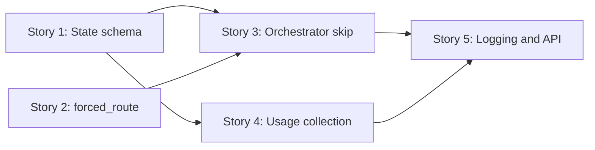

# Breakdown — PER-119

**Feature:** Skip the orchestrator's model call on hops with only one possible route, and record token usage per run

**Requirements:** `requirements-per-119.md`

**HLD:** `hld-per-119.md`

**Created:** 2025-01-22

---

## Overview

This breakdown splits the feature into five implementable stories, ordered by dependency and component boundary. The work adds forced routing (skip model calls when only one route is valid), usage tracking per node (measure savings), and orchestrator skip logic (know when to skip). Each story is a vertical slice through one component, with clear verification and no invented acceptance criteria beyond the requirements.

The opening story establishes the state schema and reducers (foundation for usage tracking and seen flags). Next, the forced routing function in `route_rules.py` (delegates to `broken_rules`, no rule duplication). Then the orchestrator skip logic in `node.py` (calls `forced_route`, checks skip conditions, tracks seen flags on both model hop and forced hop paths). Then usage collection in `run_skill`, `bindings.py`, and `ModelGateway` (extract token counts from all model call sites per the extraction contract in HLD AD-3). Finally, logging and API changes in `runner.py` (sum and report totals). All tests use a fake gateway; no live model calls.

---

## Dependencies

**Build order:** Story 1 (state schema and reducers) → Story 2 (forced routing function) → Story 3 (orchestrator skip logic) → Story 4 (usage collection at call sites) → Story 5 (logging and API). Stories 2, 3, 4 can proceed in parallel after Story 1; Story 5 waits for 3 and 4.

---

## Story Breakdown

### Story 1: State schema for usage tracking and seen flags

**Repo:** `app`

**Description:**  
Add `usage` (token counts per node) and `orchestrator_seen_flags` (track which flags the model has seen) to the state schema, with reducers that accumulate data across updates. Runs saved before this change (missing these fields) must load and resume successfully (backward compatibility). The state deserialization logic (wherever `State` is loaded from storage) must initialize missing fields to `{}` for `usage` and `set()` for `orchestrator_seen_flags` before the state is passed to reducers or used by nodes (per HLD AD-6).

**Requirements Coverage:**  
- REQ-2 AC-2.2: `State` has `usage` field: `{node: {calls, input_tokens, output_tokens, cache_creation_input_tokens, cache_read_input_tokens}}`
- REQ-2 AC-2.4: A run saved before this change loads and resumes successfully (backward compatibility: missing `usage` field does not break loading)
- REQ-3 AC-3.4: The orchestrator tracks which flags it has seen in a new state field

**Allowed Paths:**  
- `src/agents/state.py` (or wherever `State` is defined and deserialization logic lives — see story LLD for exact path)

**Dependencies:**  
None (opening story)

**Verification Approach:**  
4 tests (exact count to match later LLD/tests):

1. State with `usage` field accumulates counts per node across multiple updates (reducer deep-merges per node: adds incoming counts to existing counts for the node, or initializes if node not present)
2. State with `orchestrator_seen_flags` accumulates flag IDs across updates (reducer set union: `state.orchestrator_seen_flags |= incoming_flags`)
3. A run saved without `usage` field loads successfully, with `usage` initialized to `{}` (backward compatibility: deserialization initializes missing field before reducers run)
4. A run saved without `orchestrator_seen_flags` loads successfully, with `orchestrator_seen_flags` initialized to `set()` (backward compatibility: deserialization initializes missing field before reducers run)

All tests use a fake state loader (no live runs). Existing tests pass unchanged; `uv run pytest -q` passes.

---

### Story 2: Forced routing function in route_rules.py

**Repo:** `app`

**Description:**  
Add `forced_route(state) -> list[str] | None` to `route_rules.py`. It returns the route when exactly one candidate passes `broken_rules`, and `None` otherwise. Candidates are each node in `NODES` individually, plus every non-empty subset of stage agents (per HLD AD-4: stage agents are identified by examining the orchestrator's existing route-building code, which constructs multi-agent routes like `["agent-analyst", "agent-writer"]`; the set of stage agents is the set of nodes that appear in such routes; `forced_route` derives this from the orchestrator's route space, not hard-coded names). `broken_rules` remains the only source of routing rules; `forced_route` delegates validation (calls `broken_rules` on each candidate), no rule duplication.

**Requirements Coverage:**  
- REQ-1 AC-1.1: `forced_route(state)` returns the route as `list[str]` when exactly one candidate route passes `broken_rules`
- REQ-1 AC-1.2: `forced_route(state)` returns `None` when two or more candidate routes pass `broken_rules`
- REQ-1 AC-1.3: Candidates are: each node in `NODES` on its own, plus every non-empty set of stage agents
- REQ-1 AC-1.4: `broken_rules` is the only source of routing rules (no duplication of rule logic in `forced_route`)

**Allowed Paths:**  
- `src/agents/nodes/orchestrator/route_rules.py` (add `forced_route` function; examine existing orchestrator route-building code to identify stage agents)

**Dependencies:**  
None (independent of state changes)

**Verification Approach:**  
5 tests (exact count to match later LLD/tests):

1. `forced_route` returns `["planner"]` before the planner has run (only one candidate valid: `broken_rules(state, ["planner"])` returns `[]`, all other candidates return non-empty list)
2. `forced_route` returns `["__end__"]` after a review (only one candidate valid: `broken_rules(state, ["__end__"])` returns `[]`, all other candidates return non-empty list)
3. `forced_route` returns `["output-validator"]` once execution has finished (only one candidate valid: `broken_rules(state, ["output-validator"])` returns `[]`, all other candidates return non-empty list)
4. `forced_route` returns `None` when two unfinished stage agents with nothing waiting exist (two candidates valid: `broken_rules` returns `[]` for both, e.g., `["agent-analyst"]` and `["agent-writer"]`)
5. `forced_route` delegates validation to `broken_rules` for every candidate (verify via mocking `broken_rules`, check it is called for each enumerated candidate: each node in `NODES` individually + every non-empty subset of stage agents)

All tests use a fake state (no live runs). Existing tests pass unchanged; `uv run pytest -q` passes.

---

### Story 3: Orchestrator skip logic and seen flags tracking

**Repo:** `app`

**Description:**  
The orchestrator calls `forced_route` before `_decide`. If `forced_route` returns a route and the model has no work to do (route is not `["flag-review"]` or `["review"]`, and no unseen flags exist: all unresolved flag IDs are in `state.orchestrator_seen_flags`), skip `_decide` and use the forced route. Track which flags the orchestrator has seen on both the model hop path and the forced hop path (per HLD AD-5 clarification): extract flag IDs from `state.flags` (all unresolved flags) before writing the step (model hop or forced hop), and include the extracted flag IDs in the state update under `orchestrator_seen_flags`; the reducer merges them via set union. A forced hop writes a step with title `Next: <route>`, result `"forced: only one valid route"`, evidence `attempts: 0`, and updates `status`, `flagged`, `priority`, `confidence` exactly as a model hop would for the same route (using the same logic that interprets the model's route choice), leaving `summary` unchanged.

**Requirements Coverage:**  
- REQ-3 AC-3.1: When `forced_route` returns a route and the model has no work to do, the orchestrator skips `_decide` and uses that route
- REQ-3 AC-3.2: When `forced_route` returns a route and the route pauses for a person (`flag-review` or `review`), the orchestrator calls `_decide` (the model writes the reviewer's `summary` before a pause)
- REQ-3 AC-3.3: When `forced_route` returns a route and an unresolved flag exists that the orchestrator's model has not seen yet, the orchestrator calls `_decide` (merging duplicate flags needs the model)
- REQ-3 AC-3.4: The orchestrator updates a new state field with the flag IDs from each brief it receives (clarification from HLD AD-5: seen flags are tracked on both model hop and forced hop paths; the same flag ID extraction and state update logic applies on both paths)
- REQ-3 AC-3.5: A forced hop's step has title `Next: <route>`, result `"forced: only one valid route"`, evidence `attempts: 0`
- REQ-3 AC-3.6: A forced hop updates `status`, `flagged`, `priority`, and `confidence` exactly as a model hop does, and leaves `summary` unchanged

**Allowed Paths:**  
- `src/agents/nodes/orchestrator/node.py` (modify orchestrator logic: add forced routing check, skip conditions, seen flags tracking on both paths, forced hop step writing)

**Dependencies:**  
- After Story 1 (needs `state.orchestrator_seen_flags` schema and reducer)
- After Story 2 (calls `forced_route`)

**Verification Approach:**  
6 tests (exact count to match later LLD/tests):

1. Orchestrator skips `_decide` (no model call) when `forced_route` returns a route and model has no work (route not `["flag-review"]` or `["review"]`, and no unresolved flags exist OR all unresolved flag IDs are in `state.orchestrator_seen_flags`)
2. Orchestrator calls `_decide` (model call) when `forced_route` returns `["flag-review"]` (route pauses for a person; model writes reviewer summary)
3. Orchestrator calls `_decide` (model call) when `forced_route` returns `["review"]` (route pauses for a person; model writes reviewer summary)
4. Orchestrator calls `_decide` (model call) when `forced_route` returns a route and an unresolved flag exists whose ID is not in `state.orchestrator_seen_flags` (unseen flag; merging duplicate flags needs the model)
5. A forced hop's step has title `Next: <route>`, result `"forced: only one valid route"`, evidence `attempts: 0`
6. A forced hop updates `status`, `flagged`, `priority`, `confidence` matching a model hop for the same route, and leaves `summary` unchanged; and a forced hop updates `state.orchestrator_seen_flags` with the flag IDs from `state.flags` (same as model hop; seen flags are tracked on both paths per HLD AD-5)

All tests use a fake gateway (mock `_decide`, no live model calls). Existing tests pass unchanged; `uv run pytest -q` passes.

---

### Story 4: Usage collection at model call sites

**Repo:** `app`

**Description:**  
Extract token counts (`input_tokens`, `output_tokens`, `cache_creation_input_tokens`, `cache_read_input_tokens`) from every model call: `run_skill` (including JSON retries), the MCP tool loop in `bindings.py` (including final no-tools call), and `ModelGateway.complete`. Each call site extracts usage per the contract in HLD AD-3: `run_skill` extracts from the skill invocation response's `usage` field and from JSON retry responses' `usage` fields, sums all counts (initial + retries) into `{calls: N, input_tokens: total, ...}` where `calls` is the number of model API calls made (1 for no retry, 2 for one retry, etc.), and returns the aggregated usage with the result. The MCP tool loop extracts from each tool round response's `usage` field (including the final no-tools call), sums all rounds into `{calls: N, ...}` where `calls` is the number of model API calls (one per round), and returns the aggregated usage with the result. `ModelGateway.complete` extracts the four token count fields from the completion response and returns them in a dict `{input_tokens: int, output_tokens: int, cache_creation_input_tokens: int, cache_read_input_tokens: int}` alongside the completion; missing fields default to `0`. Nodes aggregate usage from all call sites (sum `calls` and all token count fields across `run_skill`, MCP loop, and direct `ModelGateway.complete` calls) and include the aggregated counts in their state update under `usage: {node_name: counts_dict}`.

**Requirements Coverage:**  
- REQ-2 AC-2.1: Every model call records `input_tokens`, `output_tokens`, `cache_creation_input_tokens`, and `cache_read_input_tokens` (covers `run_skill`, MCP tool loop in `bindings.py`, `ModelGateway.complete`)
- REQ-2 AC-2.3: Each node's update carries the usage of the calls it made (node aggregates usage from all its call sites and includes total in state update)
- REQ-2 AC-2.3: `usage` adds counts per node across calls, including JSON retries and every MCP tool round (extraction contract in HLD AD-3 specifies that `run_skill` sums usage across initial + retries, and MCP loop sums usage across all rounds including final no-tools call)

**Allowed Paths:**  
- `src/agents/skills/client.py` (modify `run_skill`: extract usage from skill invocation response and JSON retry responses, sum counts, return aggregated usage with result)
- `src/agents/tools/bindings.py` (modify MCP tool loop: extract usage from each tool round response including final no-tools call, sum counts, return aggregated usage with result)
- `src/agents/model/gateway.py` (modify `ModelGateway.complete`: extract four token count fields from completion response, default missing fields to `0`, return usage dict alongside completion)

**Dependencies:**  
- After Story 1 (needs `state.usage` schema and reducer)

**Verification Approach:**  
5 tests (exact count to match later LLD/tests):

1. `run_skill` extracts usage from skill invocation response (single call, no retry: `usage` field in response contains four token count fields, `run_skill` returns `{result, usage: {calls: 1, input_tokens, output_tokens, cache_creation_input_tokens, cache_read_input_tokens}}`)
2. `run_skill` sums usage across initial call and JSON retries (initial response has no JSON, retry response has JSON: `run_skill` extracts usage from both responses, sums all four token count fields, returns `{result, usage: {calls: 2, summed_counts}}`)
3. MCP tool loop in `bindings.py` sums usage across all tool rounds (three rounds: two tool calls + final no-tools call; each response has `usage` field; loop sums all four token count fields, returns `{result, usage: {calls: 3, summed_counts}}`)
4. `ModelGateway.complete` extracts usage from completion response (response has `usage` field with four token count fields; `ModelGateway.complete` returns `{completion, usage: {input_tokens, output_tokens, cache_creation_input_tokens, cache_read_input_tokens}}`)
5. A node (e.g., orchestrator) aggregates usage from multiple call sites (`run_skill` returns `{result, usage: {calls: 2, ...}}`, MCP loop returns `{result, usage: {calls: 3, ...}}`; node sums `calls` and all four token count fields across both, includes total in state update as `{usage: {orchestrator: {calls: 5, summed_counts}}}`)

All tests use a fake gateway (return mock responses with usage data, no live model calls). Existing tests pass unchanged; `uv run pytest -q` passes.

---

### Story 5: Usage logging and API response in runner.py

**Repo:** `app`

**Description:**  
`run_query` in `runner.py` sums `state.usage` across all nodes when the run ends or pauses, and logs the totals (total calls, input tokens, output tokens, cache creation tokens, cache read tokens). `GET /runs/{thread_id}` includes the same totals in the `values` field of the response (format: `{usage: {calls, input_tokens, output_tokens, cache_creation_input_tokens, cache_read_input_tokens}}`). The summing logic (iterate over `state.usage`, add each node's counts to running totals for all five fields) is extracted into a shared helper function to avoid duplication between `run_query` (for logging) and the API handler (for response).

**Requirements Coverage:**  
- REQ-2 AC-2.5: `run_query` in `src/agents/runtime/runner.py` logs the run's totals when the run ends or pauses
- REQ-2 AC-2.6: `GET /runs/{thread_id}` returns usage totals in `values`

**Allowed Paths:**  
- `src/agents/runtime/runner.py` (modify `run_query` to sum `state.usage` and log totals when run ends or pauses; modify API handler for `GET /runs/{thread_id}` to include usage totals in `values`; add shared helper function `sum_usage` to avoid duplication)

**Dependencies:**  
- After Story 3 (orchestrator writes usage to state)
- After Story 4 (all call sites write usage to state)

**Verification Approach:**  
3 tests (exact count to match later LLD/tests):

1. `run_query` sums `state.usage` across all nodes when run ends, and logs totals (5 counts: calls, input tokens, output tokens, cache creation tokens, cache read tokens; log message contains all five fields with correct summed values)
2. `run_query` sums `state.usage` across all nodes when run pauses, and logs totals (log message contains all five fields with correct summed values)
3. `GET /runs/{thread_id}` returns usage totals in `values.usage` (response includes `{values: {usage: {calls, input_tokens, output_tokens, cache_creation_input_tokens, cache_read_input_tokens}}}` with correct summed values)

All tests use a fake state (pre-populated `usage` data, no live runs). Existing tests pass unchanged; `uv run pytest -q` passes.

---

## Verification Summary

**Total test count across all stories:** 23 tests (4 + 5 + 6 + 5 + 3)

All tests use fake gateways, mock state loaders, or pre-populated state. No live model calls, no live runs. Existing tests pass unchanged; `uv run pytest -q` passes after each story.

**PR description requirement (from ticket AC):**  
Report model calls and total tokens for one service order (`run_so.py`, e.g., SO-1003) before and after the change. This measurement happens at PR time, after all stories are merged.

---

## Out of Scope

- Changing models, `policy.yaml` limits, skill or prompt content
- Shrinking `_brief`, or removing the skill container and code-execution tool from orchestrator calls
- The MCP server, the GraphQL service, or fastapi-backend
- Graph routing rules themselves: `broken_rules` behaves as today

---

## Notes

- **Design review completed:** All architectural decisions resolved in HLD (AD-1 through AD-7). State schema, forced routing algorithm (including stage agent identification by examining orchestrator route-building code), usage collection flow (extraction contract in AD-3), orchestrator skip conditions (seen flags tracked on both paths per AD-5 clarification), and backward compatibility (deserialization initializes missing fields per AD-6) all specified.
- **Single source of truth enforced:** `broken_rules` remains the only place routing rules live; `forced_route` delegates validation (Story 2 verifies via mocking).
- **Backward compatibility mandatory:** Story 1 ensures runs saved before this change load and resume (state deserialization logic initializes missing fields to empty defaults before reducers run or nodes use the state).
- **Measurement at PR time:** The PR description will report savings (model calls and tokens before/after) for one service order. This is a manual step after all stories merge, not automated in the breakdown.
- **Usage extraction contract enforced:** Story 4 follows the exact extraction contract from HLD AD-3: `run_skill` sums usage across initial + retries and `calls` is the number of model API calls; MCP loop sums usage across all rounds including final no-tools call and `calls` is the number of model API calls (one per round); `ModelGateway.complete` extracts four token count fields and defaults missing fields to `0`.
- **Seen flags tracked on both paths:** Story 3 follows the clarification in HLD AD-5 that seen flags are tracked on both the model hop path and the forced hop path; the same flag ID extraction and state update logic applies on both paths.
- **Stage agent identification specified:** Story 2 follows HLD AD-4 clarification that stage agents are identified by examining the orchestrator's existing route-building code (the code that constructs multi-agent routes); `forced_route` derives the set of stage agents from the orchestrator's route space, not hard-coded names.
