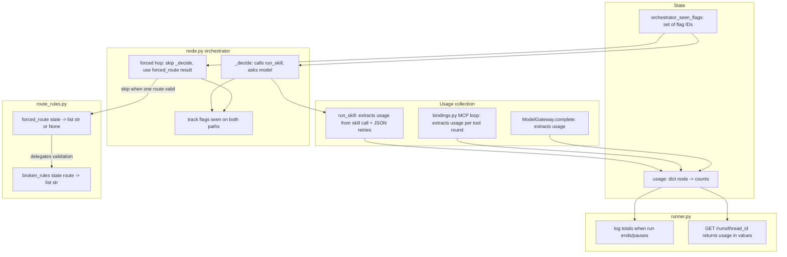
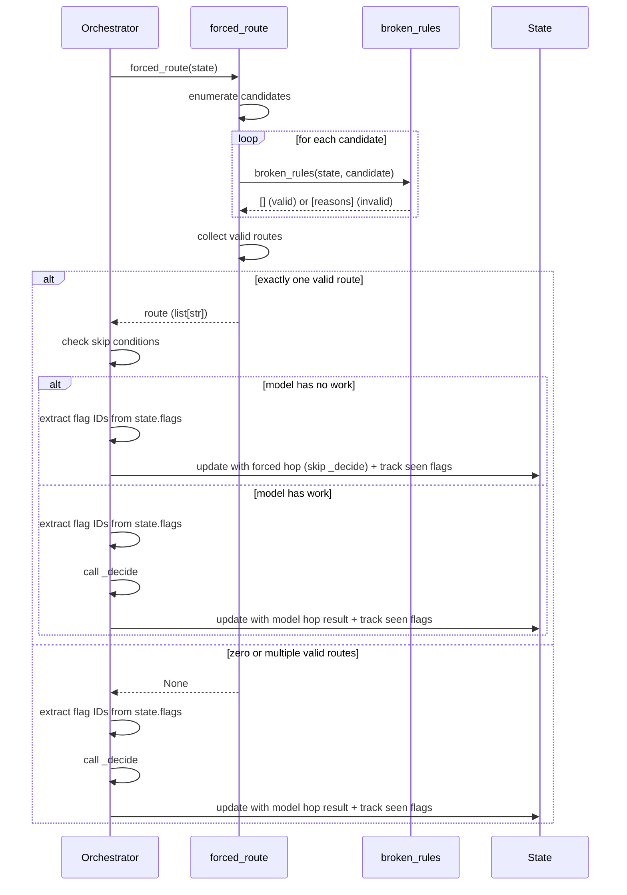
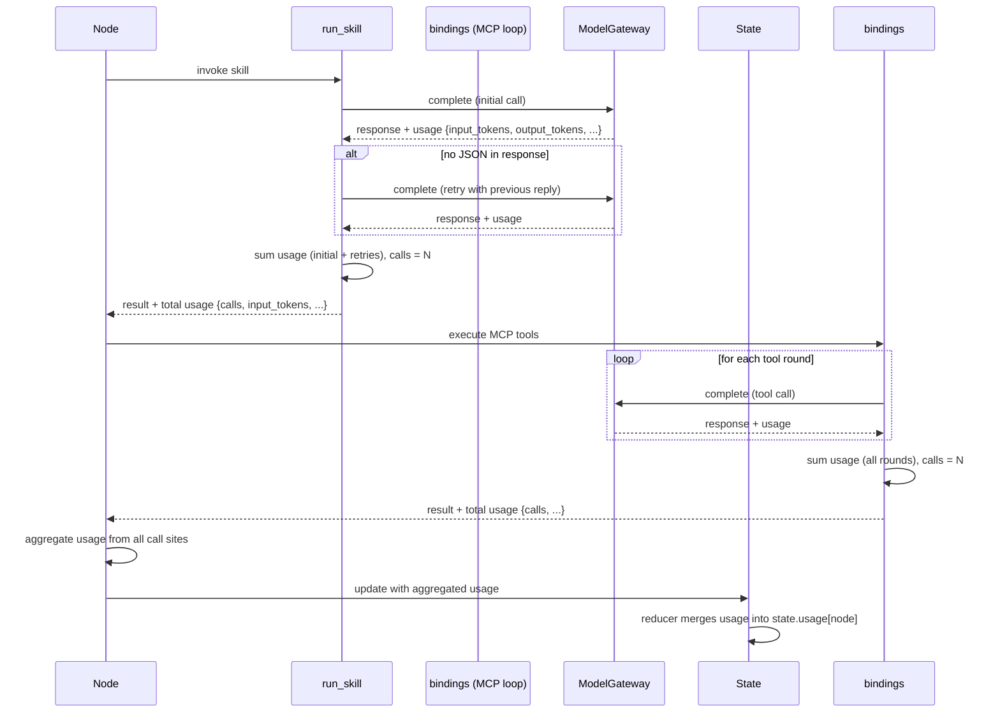

# High-Level Design — PER-119

**Feature:** Skip the orchestrator's model call on hops with only one possible route, and record token usage per run

**Requirements:** `requirements-per-119.md`

**Created:** 2025-01-22

---

## Overview

The orchestrator currently calls the model on every hop, even when only one route passes validation. Many hops have exactly one valid route (e.g., before the planner runs, after a review, once execution finishes). This work adds **forced routing** to skip model calls when only one route is valid (unless the model still has work to do: writing a reviewer summary or merging duplicate flags), and adds **usage tracking per node** so savings can be measured.

Three distinct concerns must align:

1. **State schema:** Add `usage` (token counts per node) and `orchestrator_seen_flags` (track which flags the model has seen). Both need reducers. Runs saved before this change must load and resume.
2. **Forced routing:** Add `forced_route(state) -> list[str] | None` to `route_rules.py`. It returns the route when exactly one candidate passes `broken_rules`, and `None` otherwise. It must not duplicate routing logic; `broken_rules` remains the single source of truth.
3. **Usage collection:** Every model call records `input_tokens`, `output_tokens`, `cache_creation_input_tokens`, and `cache_read_input_tokens`. This covers `run_skill` (including JSON retries), the MCP tool loop in `bindings.py` (including the final no-tools call), and `ModelGateway.complete`. Each node's update carries its usage, and the reducer aggregates per node. The runner logs totals when a run ends or pauses, and the API returns them.

This is a performance optimization and observability improvement. The orchestrator, route rules, state schema, usage collection (across `run_skill`, `bindings.py`, `ModelGateway`), and runner all change. The design review ensures these changes agree before coding.

---

## Design Paradigm

**Minimal state augmentation with backward compatibility:**  
Add two new state fields (`usage`, `orchestrator_seen_flags`) with reducers that merge incoming data into existing data. Runs saved before this change (missing these fields) must load and resume. The state schema owns the shape; the reducer owns the merge logic.

**Single source of truth for routing rules:**  
`broken_rules` remains the only place routing logic lives. `forced_route` enumerates candidate routes, calls `broken_rules` on each, and returns the route when exactly one candidate passes. No rule duplication.

**Usage as a side-effect of model calls:**  
Every model call site (three: `run_skill`, the MCP tool loop in `bindings.py`, `ModelGateway.complete`) extracts token counts from the response and adds them to a local accumulator. The node's state update carries the accumulated usage. The reducer merges it into `state.usage[node]`.

---

## System Structure

### Components and Boundaries



### Architectural Decisions

#### **AD-1: State schema for usage and seen flags**

**Binds:**  
`State.usage` is `dict[str, dict[str, int]]` where outer key is node name, inner keys are `calls`, `input_tokens`, `output_tokens`, `cache_creation_input_tokens`, `cache_read_input_tokens`. `State.orchestrator_seen_flags` is `set[str]` (flag IDs).

**Prevents:**  
Without a schema, usage data could be unstructured or incompatible with reducers. Without a seen-flags set, the orchestrator cannot know which flags it has already processed.

**Rule:**  
The state schema is the source of truth for field shape. Reducers own merge logic. Runs saved before this change (missing `usage` or `orchestrator_seen_flags`) load as if those fields were `{}` and `set()` respectively (backward compatibility).

**Status:** `[ADOPTED]` — REQ-2 AC-2.2, AC-2.4 mandate these fields and backward compatibility.

---

#### **AD-2: Reducer logic for usage aggregation**

**Binds:**  
The reducer for `usage` deep-merges per node: if `state.usage[node]` exists, add incoming counts to existing counts; otherwise, set `state.usage[node] = incoming_counts`. The reducer for `orchestrator_seen_flags` is set union: `state.orchestrator_seen_flags |= incoming_flags`.

**Prevents:**  
Without a reducer, node updates could overwrite previous usage instead of accumulating it. Without set union, the orchestrator could lose track of flags it has seen.

**Rule:**  
Every node update that includes usage must carry a dict of counts for that node. The reducer guarantees counts accumulate across updates. Every orchestrator update that includes seen flags must carry a set of flag IDs. The reducer guarantees IDs accumulate across updates.

**Status:** `[ADOPTED]` — REQ-2 AC-2.3 requires usage to accumulate per node; REQ-3 AC-3.4 requires tracking seen flags.

---

#### **AD-3: Usage collection points and extraction contract**

**Binds:**  
Three call sites collect usage:

1. **`run_skill` (`src/agents/skills/client.py`):**  
   Extract token counts from the skill invocation response's `usage` field (a dict with keys `input_tokens`, `output_tokens`, `cache_creation_input_tokens`, `cache_read_input_tokens`). If the response has no JSON and `run_skill` retries with the previous reply as context, extract counts from the retry response's `usage` field. Sum all counts (initial + retries) into a local accumulator `{calls: N, input_tokens: total, ...}` where `calls` is the number of model API calls made (1 for no retry, 2 for one retry, etc.). Return the accumulator alongside the result.

2. **MCP tool loop (`src/agents/tools/bindings.py`):**  
   Extract token counts from each tool round response's `usage` field (including the final no-tools call). Sum all rounds into a local accumulator `{calls: N, ...}` where `calls` is the number of model API calls made (one per round). Return the accumulator alongside the result.

3. **`ModelGateway.complete` (`src/agents/model/gateway.py`):**  
   Extract token counts from the completion response. The response format depends on the model client (e.g., Anthropic's Claude API returns `usage` in the response body). Parse the four token count fields from the response and return them in a dict `{input_tokens: int, output_tokens: int, cache_creation_input_tokens: int, cache_read_input_tokens: int}` alongside the completion. If any field is missing from the response, default it to `0`.

Each node that makes model calls (orchestrator, planner, agents, reviewers) aggregates usage from these sources and includes the aggregated counts in its state update.

**Prevents:**  
Without collection at these three points, usage data would be incomplete (missing retries, tool rounds, or direct completions). Without per-node aggregation, the state update would not carry the node's total usage. Without a defined extraction contract, developers would parse responses inconsistently or miss fields.

**Rule:**  
Every model call must extract `input_tokens`, `output_tokens`, `cache_creation_input_tokens`, and `cache_read_input_tokens` from the response. Missing fields default to `0`. Calls with multiple rounds (JSON retries, tool loops) sum counts across rounds, and `calls` is the number of model API calls (not the number of `run_skill` invocations). Each node sums counts from all its call sites before updating state.

**Status:** `[ADOPTED]` — REQ-2 AC-2.1, AC-2.3 require tracking usage across all model calls, including retries and tool rounds.

---

#### **AD-4: forced_route algorithm and stage agent identification**

**Binds:**  
`forced_route(state) -> list[str] | None` enumerates candidate routes, calls `broken_rules(state, route)` on each, collects routes where `broken_rules` returns an empty list (valid routes), and returns the route if exactly one is valid, else `None`.

Candidate routes are:
- Each node in `NODES` individually (as a single-element list).
- Every non-empty subset of stage agents (the power set of stage agents, excluding the empty set).

**Stage agent identification:**  
A node is a stage agent if it appears in the orchestrator's current routing logic as part of a multi-agent route (i.e., routes like `["agent-analyst", "agent-writer"]`). The authoritative source is the orchestrator's existing route-building code (likely in `node.py` or `route_rules.py`). This code already knows which nodes are stage agents because it constructs multi-agent routes for them. `forced_route` must use the same mechanism to identify stage agents. If no such mechanism exists as a constant or helper, `forced_route` must extract it: examine the orchestrator's route-building logic, identify the set of nodes that appear in multi-agent routes, and enumerate subsets of that set. Do not hard-code node names in `forced_route`; derive stage agents from the orchestrator's route space.

**Prevents:**  
Without enumerating candidates and delegating validation to `broken_rules`, `forced_route` would duplicate routing logic (violating single source of truth). Without returning `None` when multiple routes are valid, the orchestrator would force a route when a real choice exists. Without a clear stage agent identification rule, developers would enumerate the wrong candidates.

**Rule:**  
`forced_route` does not implement routing rules; it only enumerates candidates and calls `broken_rules`. `broken_rules` is the single source of truth for routing logic. Candidate enumeration must match the orchestrator's current route space (individual nodes + stage agent subsets). Stage agents are identified by examining the orchestrator's route-building code, not by hard-coding names.

**Status:** `[ADOPTED]` — REQ-1 AC-1.3, AC-1.4 require candidate enumeration and delegation to `broken_rules`. Stage agent identification clarified to resolve underspecification.

---

#### **AD-5: Orchestrator skip conditions and seen-flags tracking on both paths**

**Binds:**  
The orchestrator skips `_decide` (and thus the model call) when:

1. `forced_route(state)` returns a route (not `None`), **and**
2. The model has no work to do.

The model has work to do when:

- The forced route is `["flag-review"]` or `["review"]` (the model writes the reviewer's `summary` before a pause), **or**
- An unresolved flag exists whose ID is not in `state.orchestrator_seen_flags` (merging duplicate flags needs the model).

**Tracking seen flags on both paths:**

When the orchestrator **calls `_decide`** (model hop):
- Before calling `_decide`, extract flag IDs from `state.flags` (all unresolved flags).
- After `_decide` returns, include the extracted flag IDs in the state update under `orchestrator_seen_flags`.
- The reducer merges these IDs with existing `state.orchestrator_seen_flags` via set union.

When the orchestrator **skips `_decide`** (forced hop):
- Extract flag IDs from `state.flags` (all unresolved flags) before writing the forced hop step.
- Include the extracted flag IDs in the state update under `orchestrator_seen_flags` (same as model hop).
- The reducer merges these IDs with existing `state.orchestrator_seen_flags` via set union.

This ensures that flags are marked as seen on both the model hop path and the forced hop path. Without this, a forced hop would never mark flags as seen, causing the next hop to incorrectly call the model.

When the orchestrator skips `_decide`, it writes a step with title `Next: <route>`, result `"forced: only one valid route"`, evidence `attempts: 0`. It updates `status`, `flagged`, `priority`, and `confidence` exactly as a model hop does (using the same logic that interprets the model's route choice), and leaves `summary` unchanged.

**Prevents:**  
Without skip conditions, the orchestrator would call the model even when only one route is valid and no model work is needed. Without checking for unseen flags, the orchestrator would skip the model when duplicate flags need merging. Without checking for review routes, the orchestrator would skip the model when a reviewer summary is needed. Without tracking seen flags on the forced hop path, flags would never be marked as seen, causing unnecessary model calls on subsequent hops.

**Rule:**  
The orchestrator must call `forced_route` before `_decide`. If `forced_route` returns `None`, the orchestrator calls `_decide` as today. If `forced_route` returns a route, the orchestrator checks the skip conditions. If any condition requires the model, the orchestrator calls `_decide`. Otherwise, the orchestrator skips `_decide`, uses the forced route, writes a forced hop step, and **tracks seen flags in the state update** (same as model hop). The same flag ID extraction and state update logic applies on both paths.

**Status:** `[ADOPTED]` — REQ-3 AC-3.1, AC-3.2, AC-3.3, AC-3.4, AC-3.5, AC-3.6 require skip conditions, seen-flags tracking, and forced hop step format. Seen-flags tracking clarified to apply on both paths, resolving the gap in the original spec.

---

#### **AD-6: Backward compatibility implementation location**

**Binds:**  
Backward compatibility (initializing missing `usage` and `orchestrator_seen_flags` fields to `{}` and `set()` respectively) is implemented in the state deserialization logic. This is the code that loads a run state from storage (e.g., from a database, file, or cache). The exact location depends on the codebase's state management pattern. Common patterns:

- **Pydantic model with `model_validate`:** Add `@model_validator(mode='before')` to the `State` model that initializes missing fields before validation.
- **Dataclass with custom `__post_init__`:** Add initialization logic in `__post_init__` that checks for missing fields and sets defaults.
- **Manual deserialization function:** Add initialization logic to the function that deserializes state from storage (e.g., `load_run_state(thread_id)`).

The implementation must locate the state deserialization code and add the initialization logic there. If the codebase uses a reducer-based state system with a separate loader, the initialization may belong in the loader rather than the state class itself.

**Prevents:**  
Without specifying where backward compatibility logic lives, developers would add it to the wrong place (e.g., in the reducer instead of the loader), and the initialization might not run when a run is resumed.

**Rule:**  
Backward compatibility initialization must run during deserialization (when loading a saved run), before the state is passed to reducers or used by nodes. The initialization logic must check if `usage` or `orchestrator_seen_flags` are missing and set them to `{}` and `set()` respectively. The exact implementation location depends on the codebase's state management pattern; developers must locate the deserialization code and add the initialization there.

**Status:** `[ADOPTED]` — REQ-2 AC-2.4 requires backward compatibility. Implementation location clarified to resolve underspecification.

---

#### **AD-7: Usage logging and API response**

**Binds:**  
`run_query` in `src/agents/runtime/runner.py` sums `state.usage` across all nodes when the run ends or pauses, and logs the totals (total calls, total input tokens, total output tokens, total cache creation tokens, total cache read tokens). `GET /runs/{thread_id}` includes the same totals in the `values` field of the response.

**Prevents:**  
Without logging, savings cannot be measured. Without API exposure, clients cannot access usage data.

**Rule:**  
The runner must sum `state.usage` values when the run ends or pauses. The API must return the summed usage in `values`. The format is:

```python
{
  "usage": {
    "calls": <int>,
    "input_tokens": <int>,
    "output_tokens": <int>,
    "cache_creation_input_tokens": <int>,
    "cache_read_input_tokens": <int>
  }
}
```

**Status:** `[ADOPTED]` — REQ-2 AC-2.5, AC-2.6 require logging totals and returning them in the API response.

---

## Data and State

### State Schema Changes

**New fields in `State`:**

1. **`usage: dict[str, dict[str, int]]`** — Outer key is node name. Inner dict has keys: `calls`, `input_tokens`, `output_tokens`, `cache_creation_input_tokens`, `cache_read_input_tokens`. All values are `int`.
2. **`orchestrator_seen_flags: set[str]`** — Flag IDs the orchestrator has seen (updated on both model hop and forced hop paths).

**Backward compatibility:**  
Runs saved before this change (missing `usage` or `orchestrator_seen_flags`) must load as if these fields were `{}` and `set()` respectively. The state deserialization code must initialize missing fields to their empty defaults (see AD-6 for implementation location).

**Reducers:**

- **`usage` reducer:** For each node in the incoming update, add counts to `state.usage[node]`. If the node does not exist in `state.usage`, initialize it with the incoming counts. Otherwise, add each incoming count to the existing count.
- **`orchestrator_seen_flags` reducer:** Set union. `state.orchestrator_seen_flags |= incoming_flags`.

---

### Usage Data Shape

**Per-call usage (returned by `ModelGateway.complete`):**

```python
{
  "input_tokens": int,
  "output_tokens": int,
  "cache_creation_input_tokens": int,
  "cache_read_input_tokens": int
}
```

**Per-node usage (in state):**

```python
{
  "calls": int,  # total number of model API calls this node made
  "input_tokens": int,
  "output_tokens": int,
  "cache_creation_input_tokens": int,
  "cache_read_input_tokens": int
}
```

**Total usage (logged and returned by API):**

Sum of all nodes' `calls`, `input_tokens`, `output_tokens`, `cache_creation_input_tokens`, `cache_read_input_tokens`.

---

### Example State Update (Orchestrator)

Before:

```python
state.usage = {}
state.orchestrator_seen_flags = set()
```

Orchestrator makes a model call with usage `{input_tokens: 1000, output_tokens: 50, cache_creation_input_tokens: 500, cache_read_input_tokens: 200}`. The state contained flag IDs `["flag-1", "flag-2"]`.

Update payload:

```python
{
  "usage": {
    "orchestrator": {
      "calls": 1,
      "input_tokens": 1000,
      "output_tokens": 50,
      "cache_creation_input_tokens": 500,
      "cache_read_input_tokens": 200
    }
  },
  "orchestrator_seen_flags": {"flag-1", "flag-2"}
}
```

After (state reducer applied):

```python
state.usage = {
  "orchestrator": {
    "calls": 1,
    "input_tokens": 1000,
    "output_tokens": 50,
    "cache_creation_input_tokens": 500,
    "cache_read_input_tokens": 200
  }
}
state.orchestrator_seen_flags = {"flag-1", "flag-2"}
```

---

## Interactions and Workflows

### Forced Routing Workflow



### Usage Collection Workflow



---

## Open Questions

_(none at this time)_

---

## Risks and Mitigation

### **RISK-1: Backward compatibility failure**

**Risk:** Runs saved before this change fail to load because `usage` or `orchestrator_seen_flags` fields are missing.

**Mitigation:** The state deserialization code must initialize missing fields to their empty defaults (`{}` for `usage`, `set()` for `orchestrator_seen_flags`). Test coverage must include loading a run saved without these fields and verifying it resumes successfully. See AD-6 for implementation location.

**Likelihood:** Low (standard backward compatibility pattern).  
**Impact:** High (breaks existing runs).

---

### **RISK-2: Usage collection incomplete**

**Risk:** Usage data is missing from JSON retries, MCP tool rounds, or direct completions.

**Mitigation:** All three call sites (`run_skill`, `bindings.py` MCP loop, `ModelGateway.complete`) must extract usage from every response per the extraction contract in AD-3. Missing fields default to `0`. Test coverage must verify usage accumulates across retries and tool rounds. Story 4 tests cover this.

**Likelihood:** Low (extraction contract in AD-3 specifies exact behavior).  
**Impact:** High (usage data is incomplete, savings cannot be measured).

---

### **RISK-3: forced_route duplicates routing logic**

**Risk:** `forced_route` implements routing rules directly instead of delegating to `broken_rules`, violating single source of truth.

**Mitigation:** `forced_route` must only enumerate candidates and call `broken_rules` on each. Code review must verify no rule logic lives in `forced_route`. Test coverage must verify `forced_route` behavior matches `broken_rules` validation. Story 2 tests cover this via mocking `broken_rules` and verifying it is called for each candidate.

**Likelihood:** Low (design enforces delegation, AD-4 specifies algorithm).  
**Impact:** High (routing logic diverges, maintenance burden increases).

---

### **RISK-4: Orchestrator skip conditions incorrect**

**Risk:** The orchestrator skips `_decide` when the model has work to do (e.g., a new flag needs merging, a reviewer summary is needed), or calls the model when no work is needed.

**Mitigation:** The orchestrator must check skip conditions (forced route is not `flag-review` or `review`, and no unseen flags exist) before skipping `_decide`. Test coverage must verify the orchestrator calls the model when the forced route is `flag-review` or `review`, and when an unseen flag exists. Story 3 tests cover this.

**Likelihood:** Low (AD-5 specifies exact skip conditions).  
**Impact:** High (model is called unnecessarily, or skipped when needed).

---

### **RISK-5: Seen flags not tracked on forced hop path**

**Risk:** Forced hops do not mark flags as seen, causing the next hop to incorrectly call the model even though the flags were already present.

**Mitigation:** The orchestrator must track seen flags on both the model hop path and the forced hop path (see AD-5). The same flag ID extraction and state update logic applies on both paths. Test coverage must verify seen flags are updated on forced hops. Story 3 tests cover this.

**Likelihood:** Low (AD-5 explicitly requires tracking on both paths).  
**Impact:** High (defeats the savings goal; unnecessary model calls).

---

### **RISK-6: Stage agent enumeration incorrect**

**Risk:** `forced_route` enumerates the wrong candidates because it hard-codes node names or misidentifies stage agents.

**Mitigation:** `forced_route` must derive stage agents from the orchestrator's route-building code, not hard-code names (see AD-4). Code review must verify stage agent identification matches the orchestrator's route space. Story 2 tests verify candidate enumeration matches expected routes for known states.

**Likelihood:** Low (AD-4 specifies derivation rule).  
**Impact:** Medium (missed optimization opportunities, but system still functions).

---

## Deferred Decisions

- **Size of savings:** The PR description will report model calls and total tokens for one service order before and after the change. Ongoing measurement and optimization of forced routing (e.g., identifying more forced hops) is out of scope.
- **Further orchestrator optimizations:** Shrinking `_brief`, removing the skill container or code-execution tool, or changing models/prompts is out of scope.
- **Usage aggregation by model:** This design aggregates usage per node. Aggregating per model (if multiple models are used) is deferred.
- **Usage storage:** This design tracks usage in `State` for the duration of a run. Persisting usage to a database or metrics system is deferred.

---

## Implementation Notes

- **File locations:**
  - `State` schema: likely in `src/agents/state.py` or similar (verify from repo tree).
  - `forced_route`: add to `src/agents/nodes/orchestrator/route_rules.py`.
  - Orchestrator logic: `src/agents/nodes/orchestrator/node.py`.
  - Usage collection: `src/agents/skills/client.py` (`run_skill`), `src/agents/tools/bindings.py` (MCP loop), `src/agents/model/gateway.py` (`ModelGateway.complete`).
  - Runner: `src/agents/runtime/runner.py` (`run_query`).
- **Test setup:** Use a fake gateway (mock `ModelGateway`) to avoid live model calls. Verify forced routing, skip conditions, usage accumulation, and backward compatibility.
- **Existing tests:** Must pass unchanged. `uv run pytest -q` must pass.
- **Test counts (per breakdown):**
  - Story 1: 4 tests (state schema and reducers)
  - Story 2: 5 tests (`forced_route` behavior)
  - Story 3: 6 tests (orchestrator skip logic and seen flags)
  - Story 4: 5 tests (usage collection at call sites)
  - Story 5: 3 tests (logging and API)
  - Total: 23 tests

---

## Success Criteria

- New tests cover: `forced_route` behavior (returns route when one candidate valid, `None` when multiple valid, delegates to `broken_rules` for validation), orchestrator skip logic (no model call on forced hop unless model has work, calls model when forced route is `flag-review`/`review` or unseen flag exists, tracks seen flags on both paths), forced hop step format, usage aggregation across retries and tool rounds (per extraction contract in AD-3), backward compatibility for runs without `usage` or `orchestrator_seen_flags`.
- Existing tests pass unchanged; `uv run pytest -q` passes.
- PR description reports model calls and total tokens for one service order before and after the change.
- All 23 tests (per breakdown) pass, with counts matching exactly: 4 + 5 + 6 + 5 + 3.
