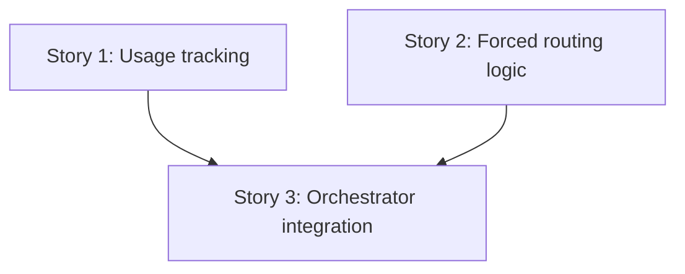

# breakdown.md — PER-128

**Epic:** PER-128  
**Title:** Skip the orchestrator's model call on hops with only one possible route, and record token usage per run

---

## Epic Summary

The orchestrator makes the most calls in the system, and many hops have only one route that `broken_rules` would accept. This epic adds **forced routing** to skip model calls when the route is deterministic (and no model work remains), and **per-run token usage tracking** so we can measure the saving. The work splits into three stories: (1) usage tracking in State and model gateways, (2) forced routing logic in `route_rules.py`, (3) orchestrator integration and runtime aggregation.

---

## Requirements Coverage

All acceptance criteria from `requirements.md` are covered by the three stories below:

- **AC1 (Token usage per run):** Story 1 adds `State.usage`, reducer logic, and recording at all model call sites; Story 3 adds runtime aggregation and API response.
- **AC2 (Forced routing logic):** Story 2 implements `forced_route` with `broken_rules` as the sole rule source.
- **AC3 (Orchestrator integration):** Story 3 integrates `forced_route`, implements skip conditions (two exceptions: reviewer summary, unseen flags), and tracks `seen_flags`.
- **AC4 (Automated test coverage):** Each story includes tests per its scope; Story 3 runs the full suite and includes before/after metrics.
- **AC5 (Demonstrable savings):** Story 3's PR description reports model calls and tokens before/after for one service order.

---

## Story Breakdown

### Story 1: Add token usage tracking to State and model gateways

**Repo:** `agent`

**Description:**  
Extend `State` with a `usage` field (`Dict[str, UsageStats]`) that aggregates token counts per node. Implement an additive reducer (sum new counts into existing). Modify all model call sites (`run_skill` in `client.py`, MCP tool loop in `bindings.py`, `ModelGateway.complete`) to extract four token counts from API responses (`input_tokens`, `output_tokens`, `cache_creation_input_tokens`, `cache_read_input_tokens`) and return a `UsageStats` delta with `calls: 1`. Ensure the state loader treats missing `usage` (old runs) as `{}` so they load without error. Define `UsageStats` dataclass with an additive `__add__` method to support the reducer.

**Covers:**
- AC1.1 (record counts per call in `State.usage`)
- AC1.2 (accumulate per node, not replace)
- AC1.3 (runs saved without `usage` load without error)
- AC4.7 (usage accumulation tests)
- AC4.8 (state migration test)
- AC4.9 (existing tests pass)

**After:** _(none — foundational)_

**Verification Approach:**  
5 new tests in `tests/test_usage_tracking.py`:
1. Usage accumulates across two calls for same node (assert `calls == 2`, tokens summed) — covers AC1.2
2. JSON retry in `run_skill` contributes to usage (assert retry call counted) — covers AC1.1
3. MCP tool loop's three rounds accumulate (assert `calls == 3`) — covers AC1.1
4. State loads without error when `usage` is missing (assert `state.usage == {}`) — covers AC1.3, AC4.8
5. `UsageStats` correctly extracts from mocked API response (assert all four fields) — covers AC1.1

All existing tests pass unchanged (`uv run pytest -q`) — covers AC4.9.

**Allowed paths (developer must locate actual paths before implementation):**  
- State schema definition (add `usage` field, implement reducer)
- State loader (handle missing `usage`)
- Skill client (modify `run_skill`)
- Tool bindings (modify MCP tool loop)
- Model gateway (modify `ModelGateway.complete`)
- Node update logic (include usage delta in updates)
- UsageStats dataclass definition (new)
- Test file `tests/test_usage_tracking.py` (new)

---

### Story 2: Implement forced routing logic in route_rules.py

**Repo:** `agent`

**Description:**  
Add `forced_route(state) -> list[str] | None` to the route_rules module. It generates candidates (each node in `NODES` as a single-element list, plus every non-empty combination of stage agents) and tests each against `broken_rules`. Returns the route when exactly one candidate passes, `None` otherwise. `broken_rules` remains the sole source of routing rules; `forced_route` does not duplicate any logic. Before implementation, locate `NODES` and stage agent constants in the codebase; if not centralized, document the assumed set and flag for architect review.

**Covers:**
- AC2.1 (return single route when exactly one candidate passes)
- AC2.2 (pre-planner → `["planner"]`)
- AC2.3 (post-review → `["__end__"]`)
- AC2.4 (post-execution → `["output-validator"]`)
- AC2.5 (multiple valid routes → `None`)
- AC2.6 (`broken_rules` is sole rule source)
- AC4.2 (forced_route deterministic routes tests)
- AC4.3 (forced_route with multiple valid routes test)

**After:** _(none — foundational)_

**Verification Approach:**  
7 new tests in `tests/test_forced_route.py`:
1. Pre-planner state → `forced_route` returns `["planner"]` — covers AC2.2, AC4.2
2. Post-review state → `forced_route` returns `["__end__"]` — covers AC2.3, AC4.2
3. Post-execution state → `forced_route` returns `["output-validator"]` — covers AC2.4, AC4.2
4. Two unfinished agents, nothing waiting → `forced_route` returns `None` — covers AC2.5, AC4.3
5. Mock `broken_rules` spy → assert called for each candidate, no logic outside those calls — covers AC2.6
6. One valid route among many candidates → returns that route — covers AC2.1
7. Zero valid routes → returns `None` — covers AC2.1

All existing `route_rules` tests pass unchanged — covers AC4.9.

**Allowed paths (developer must locate actual paths before implementation):**  
- Route rules module (add `forced_route`)
- Test file `tests/test_forced_route.py` (new)

---

### Story 3: Integrate forced routing into orchestrator node

**Repo:** `agent`

**Description:**  
At each orchestrator decision point, call `forced_route(state)`. When it returns a route, skip `_decide` unless: (1) the route is `["flag-review"]` or `["review"]` (model must write reviewer summary), or (2) an unresolved flag exists whose ID is not in `state.seen_flags` (model must merge flags). A forced hop records a step (title `Next: <route>`, result `"forced: only one valid route"`, evidence `attempts: 0`) and updates `status`, `priority`, `confidence` by calling the same helper functions (`_compute_status_for_route`, `_compute_priority_for_route`, `_compute_confidence_for_route`) that model hops use (leaves `summary` unchanged). After every model call, extract flag IDs from the brief and add them to `state.seen_flags` via the reducer. Extend `State` with `seen_flags: Set[str]` and implement the union reducer. At run end/pause, the runtime handler sums `state.usage` across nodes and logs totals (calls, input tokens, output tokens, cache creation tokens, cache read tokens). The run status API includes the totals in its response payload under `values.total_usage` (developer must verify this nesting matches the actual API schema before implementing).

**Covers:**
- AC3.1 (skip `_decide` when forced route and no model work needed)
- AC3.2 (forced hop step structure)
- AC3.3 (model called when route is `["flag-review"]` or `["review"]`)
- AC3.4 (model called when unseen flag exists)
- AC3.5 (`seen_flags` updated after model call)
- AC1.4 (runtime logs usage totals)
- AC1.5 (API returns usage totals)
- AC4.1 (all new tests pass)
- AC4.4 (orchestrator model call decision tests)
- AC4.5 (model called when needed tests)
- AC4.6 (forced hop step structure tests)
- AC4.7 (usage accumulation tests at integration level)
- AC4.8 (state migration test at integration level)
- AC4.9 (existing tests pass)
- AC5.1 (PR description includes before/after metrics)

**After:** Story 1 (requires `State.usage` schema), Story 2 (requires `forced_route` API)

**Verification Approach:**  
10 new tests across two test files:

`tests/agents/nodes/test_orchestrator_forced_routing.py` (6 tests):
1. Forced hop with no pause, no unseen flags → no model call (assert via gateway mock) — covers AC3.1, AC4.4
2. Forced route `["flag-review"]` → model called (assert gateway call) — covers AC3.3, AC4.5
3. Unresolved flag not in `seen_flags` → model called (assert gateway call) — covers AC3.4, AC4.5
4. Forced hop step structure matches expectations (assert title, result, evidence, status/priority/confidence) — covers AC3.2, AC4.6
5. `seen_flags` updated after model call (assert flag IDs added) — covers AC3.5
6. Forced hop and model hop produce same status/priority/confidence when computed from different initial states (verify helper function call patterns, not outputs) — covers AC3.2, AC4.6

`tests/agents/integration/test_usage_tracking.py` (4 tests):
1. Usage accumulates across multiple calls (assert sum per node) — covers AC4.7
2. Run with no `usage`/`seen_flags` fields loads and resumes (assert no error, using a state dict with all required fields discovered from schema scan, except `usage` and `seen_flags`) — covers AC4.8
3. Runtime handler logs totals at run end (assert log output) — covers AC1.4
4. Run status API returns totals in response payload (assert correct nesting at `values.total_usage`, verified against actual API schema) — covers AC1.5

All existing tests pass unchanged (`uv run pytest -q`) — covers AC4.9.

**PR description includes:** Before/after measurements for one service order (e.g. SO-1003 via `run_so.py`): model call count, total input tokens, total output tokens, total cache creation tokens, total cache read tokens — covers AC5.1.

**Allowed paths (developer must locate actual paths before implementation):**  
- Orchestrator node (integrate `forced_route`, skip logic, forced hop recording via helper functions, seen flags tracking)
- State schema (add `seen_flags` field, implement union reducer)
- Runtime handler (aggregate and log usage totals)
- API routes module (extend run status response with `values.total_usage`)
- Test file `tests/agents/nodes/test_orchestrator_forced_routing.py` (new)
- Test file `tests/agents/integration/test_usage_tracking.py` (new)

---

## Dependencies Between Stories

- **Story 1 and Story 2** are independent foundational work.
- **Story 3** depends on both Story 1 (`State.usage` schema, reducer) and Story 2 (`forced_route` API).

---

## Out of Scope (from ticket)

- Changing models, `policy.yaml` limits, skill or prompt content
- Shrinking `_brief`, or removing the skill container and code-execution tool from orchestrator calls
- The MCP server, the GraphQL service, and fastapi-backend
- Graph routing rules themselves: `broken_rules` behaves as today

---

## Verification Summary

| Story | Test Count | Scope |
|-------|------------|-------|
| 1 | 5 | Usage accumulation (AC1.1, AC1.2), state migration (AC1.3, AC4.8), extraction from all call sites (AC1.1), existing tests pass (AC4.9) |
| 2 | 7 | Forced route deterministic behavior (AC2.2, AC2.3, AC2.4, AC4.2), multiple valid routes (AC2.5, AC4.3), rule delegation (AC2.6), single/zero valid routes (AC2.1) |
| 3 | 10 | Orchestrator skip decisions (AC3.1, AC4.4), model called when needed (AC3.3, AC3.4, AC4.5), forced hop structure (AC3.2, AC4.6), seen flags tracking (AC3.5), usage aggregation (AC4.7), state migration (AC4.8), runtime logging (AC1.4), API response (AC1.5), existing tests pass (AC4.9), before/after metrics (AC5.1) |
| **Total** | **22** | New tests; all existing tests must pass (AC4.9) |

---

## Notes

- **Repo-tree not mapped:** All file paths are placeholders. Developer must locate actual paths from the codebase before implementation. Story 2 must locate `NODES` and stage agent constants; Story 3 must verify the run status API response structure (confirm `values.total_usage` nesting matches actual schema).
- **Test strategy:** All new tests use fake gateways (no live model calls). Existing tests verify backward compatibility.
- **State migration:** Story 1 ensures runs saved before this change load without error (missing `usage` treated as `{}`). Story 3 adds `seen_flags` (missing treated as `set()`). Test 2 in Story 3's integration tests must use a state dict with all required schema fields (discovered from State schema scan) except `usage` and `seen_flags` to avoid schema validation errors before the loader's check runs.
- **Metrics:** Story 3's PR description reports the saving (model calls and tokens before/after for one service order) per AC5.1.
- **UsageStats design:** Story 1 defines `UsageStats` with `__add__` to support the reducer's additive merge. The reducer loops over nodes and assigns `existing[node] + delta[node]`, leveraging the dataclass method.
- **Forced hop computation:** Story 3's `_record_forced_hop` calls the same helper functions (`_compute_status_for_route`, `_compute_priority_for_route`, `_compute_confidence_for_route`) that model hops use, ensuring equivalence. Test 6 verifies this by comparing call patterns or outcomes from different initial states where the helpers produce different results, not by circular mocking.
- **API response structure:** Story 3 assumes `values.total_usage` nesting per HLD AD-5, but developer must verify this against the actual API schema before implementing. Test 4 in integration tests asserts this structure; if the real schema differs, the test and implementation must both be updated.

---

**End of breakdown.md**
