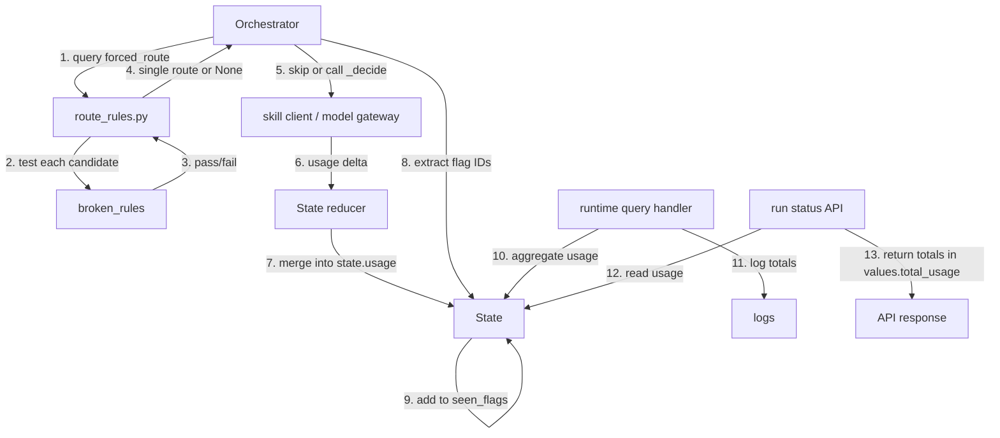

# High-Level Design — PER-128

## Overview

PER-128 adds **forced routing** (skipping model calls when only one valid route exists) and **per-run token usage tracking** to the orchestrator. The design introduces a new `forced_route` component in `route_rules.py`, extends `State` with `usage` and `seen_flags` fields, and modifies the orchestrator's decision flow to skip model calls when safe. All model gateways and the orchestrator record token usage per call, and the runtime aggregates and logs totals per run.

---

## Architecture Decisions

### AD-1: State schema extensions

**Binds:** `State` schema in the agent's state management layer  
**Prevents:** Divergent schemas across orchestrator, runtime, and persistence  
**Rule:** [ADOPTED]

`State` gains two new fields:

- `usage: Dict[str, UsageStats]` — maps node name to aggregated token counts (`calls`, `input_tokens`, `output_tokens`, `cache_creation_input_tokens`, `cache_read_input_tokens`). The reducer **adds** incoming counts to existing ones (never replaces).
- `seen_flags: Set[str]` — flag IDs the orchestrator's model has observed in briefs. The reducer **unions** incoming IDs with existing ones.

**Migration:** Runs saved before this change have no `usage` or `seen_flags`. The loader treats missing fields as empty (`{}` for `usage`, `set()` for `seen_flags`) and execution continues normally.

**Rationale:** Aggregating usage at the state level keeps all token accounting in one place and survives pauses/resumes. Tracking seen flags in state (not ephemeral per-hop memory) ensures correct behavior across pauses and reruns.

---

### AD-2: `forced_route` contract

**Binds:** `route_rules.py` public API  
**Prevents:** Orchestrator and routing logic duplicating route validity checks  
**Rule:** [ADOPTED]

`forced_route(state) -> list[str] | None` returns a single route when exactly one candidate passes `broken_rules`, and `None` otherwise.

- **Candidates:** every individual node in `NODES` (as a single-element list), plus every non-empty combination of stage agents (e.g. `["analyst", "architect"]`).
- **Rule source:** `broken_rules` remains the **sole** source of routing rules. `forced_route` queries `broken_rules` for each candidate and counts passing routes; it does **not** reimplement any rule logic.

**Rationale:** Generating candidates exhaustively (individual nodes + agent sets) ensures we catch forced routes in all phases (pre-planner, between agents, post-review). Delegating validity checks to `broken_rules` avoids duplicating complex state-dependent rules and keeps one source of truth.

---

### AD-3: Orchestrator skip conditions

**Binds:** `_decide` call in orchestrator node  
**Prevents:** Unnecessary model calls when the route is deterministic and no model work remains  
**Rule:** [ADOPTED]

When `forced_route` returns a route, the orchestrator skips `_decide` (no model call) **unless**:

1. The route is `["flag-review"]` or `["review"]` — the model must write the reviewer's `summary` before pausing.
2. An unresolved flag exists whose ID is **not** in `state.seen_flags` — the model must merge duplicate flags or address new flags.

When skipped, the orchestrator records a step with title `Next: <route>`, result `"forced: only one valid route"`, evidence `attempts: 0`, and updates `status`, `flagged`, `priority`, `confidence` as a model hop would (leaves `summary` unchanged). After every model call, the orchestrator extracts flag IDs from the brief and adds them to `state.seen_flags`.

**Rationale:** The two exceptions (reviewer summary, unseen flags) are work only the model can do, even when the route is deterministic. Tracking seen flags ensures we don't skip the model when a new flag appears mid-run.

---

### AD-4: Usage recording contract

**Binds:** All model call sites (skill client, MCP tool loop, model gateway)  
**Prevents:** Missing or inconsistent token counts  
**Rule:** [ADOPTED]

Every model call records four counts from the API response: `input_tokens`, `output_tokens`, `cache_creation_input_tokens`, `cache_read_input_tokens`. Each node's update carries a `UsageStats` delta with `calls: 1` and the four token fields. The state reducer sums these into the node's existing counts.

**Scope:**
- Skill client — includes JSON retry calls
- MCP tool loop — one update per round (including the final no-tools call)
- Model gateway — direct completions (e.g. for summaries or flag merges)

**Rationale:** Recording at every call site (including retries and tool rounds) captures the full cost. The reducer's additive merge ensures counts survive pauses and accumulate correctly across hops.

---

### AD-5: Runtime aggregation and logging

**Binds:** Runtime query handler and run status API  
**Prevents:** Silent runs with no cost visibility  
**Rule:** [ADOPTED]

When a run ends or pauses, the runtime sums `state.usage` across all nodes and logs the totals (total calls, total input tokens, total output tokens, total cache creation, total cache read). The run status API returns these totals in the response.

**API response structure:** The totals nest under `values.total_usage` in the `GET /runs/{thread_id}` response, preserving existing `values` fields. Story 3 verifies this structure before implementing to ensure compatibility with existing clients.

**Rationale:** Logging at run boundaries (not per-hop) keeps logs clean and gives a single number for cost analysis. Returning totals in the API makes them available to dashboards and cost tracking tools.

---

## Deferred Decisions

- **Candidate generation algorithm:** The HLD specifies exhaustive enumeration of individual nodes + agent sets. If performance becomes an issue with many agents, a smarter candidate generator (e.g. based on `NODES` topology) can replace it without changing the `forced_route` contract.
- **Usage granularity:** Today we track per node. If future cost analysis needs per-hop or per-call breakdowns, `usage` can nest deeper (e.g. `{node: {hop_id: UsageStats}}`). The reducer contract supports this.
- **Brief shrinking:** The ticket excludes shrinking `_brief` content. If forced routing proves insufficient, `_brief` can omit completed results or older flags without changing the routing or usage design.

---

## Data Schemas

### State extensions

```python
# New fields in State
usage: Dict[str, UsageStats]  # node name -> aggregated counts
seen_flags: Set[str]          # flag IDs the orchestrator's model has seen
```

### UsageStats

```python
@dataclass
class UsageStats:
    calls: int
    input_tokens: int
    output_tokens: int
    cache_creation_input_tokens: int
    cache_read_input_tokens: int
```

### forced_route API

```python
def forced_route(state: State) -> list[str] | None:
    """
    Returns a single route if exactly one candidate passes broken_rules.
    Candidates: each node in NODES (alone), plus every non-empty set of stage agents.
    Returns None if zero or multiple candidates pass.
    """
```

---

## Component Interactions



**Flow:**

1. Orchestrator calls `forced_route(state)` at each decision point.
2. `forced_route` generates candidates and tests each against `broken_rules`.
3. `broken_rules` returns pass/fail per candidate (using existing rule logic).
4. `forced_route` returns a route if exactly one candidate passed, else `None`.
5. Orchestrator skips `_decide` if route is forced and no model work remains; otherwise calls the model.
6. Every model call returns a usage delta (`UsageStats` with `calls: 1` and token counts).
7. State reducer merges the delta into `state.usage[node]` (additive).
8. After each model call, orchestrator extracts flag IDs from the brief.
9. Orchestrator updates `state.seen_flags` via reducer.
10. At run end/pause, runtime query handler sums `state.usage` across nodes.
11. Runtime logs aggregated totals.
12. Run status API reads `state.usage`.
13. API returns totals under `values.total_usage` in response payload.

---

## Risks and Mitigations

| Risk | Impact | Mitigation |
|------|--------|-----------|
| `forced_route` candidate generation is slow with many agents | High call latency at each orchestrator hop | Profile with realistic agent counts; if needed, cache candidates or use topology-based pruning (see Deferred). |
| Missing usage from a call site | Underreported costs, misleading savings claims | Exhaustive code review of all model gateway call paths; add integration test asserting usage appears for every known call type (Story 1). |
| State migration breaks existing runs | Runs fail to load after deploy | Loader treats missing fields as empty (specified in AD-1); Story 1 and Story 3 add tests loading pre-change state snapshots. |
| Forced route taken when model work was needed | Wrong summary or unmerged flags | The two skip exceptions (reviewer summary, unseen flags) are explicit in AD-3; Story 3 adds tests covering both cases (Tests 2, 3). |
| Forced hop and model hop produce different status updates | Inconsistent state transitions | Story 3 Test 6 compares forced hop and model hop outcomes from different initial states where status/priority/confidence diverge, catching any computation discrepancy. |

---

## Open Questions

**Resolved before breakdown:**

1. **Where are `NODES` and `STAGE_AGENTS` defined?** — Story 2 must locate these constants or registries in the codebase before implementing `forced_route`. If not found, the story documents the assumed set and flags it for architect review.

2. **What is the existing structure of the run status API response?** — Story 3 must scan the codebase to verify where `total_usage` nests within `GET /runs/{thread_id}` response before implementing. AD-5 specifies `values.total_usage` as the target structure, but Story 3 confirms this matches the actual API schema and preserves existing `values` fields.

---

**End of hld.md**
