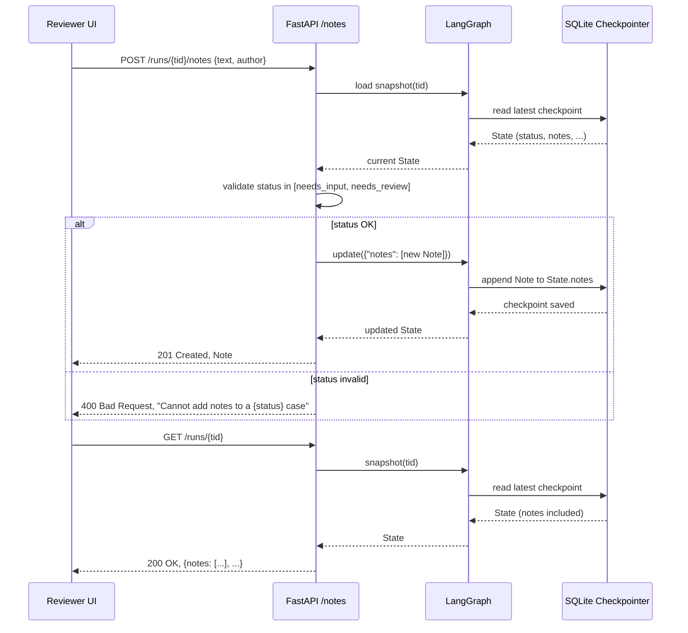

# High-Level Design — PER-199

**Feature:** Reviewers can leave notes on a case  
**Date:** 2025-01-24  
**Repo:** `agent` (Python, LangGraph)

---

## Overview

Add persistent, immutable notes to paused cases so reviewers can leave context for the next person picking up the case. Notes are stored in the `State` structure alongside flags and summary, displayed in the case timeline, and kept across resume/pause cycles and service restarts.

---

## Architecture Decisions

### AD-1: Notes as append-only State list

**Binds:** Notes live in `State` as `notes: Annotated[list[Note], operator.add]`, added by a new `/runs/{thread_id}/notes` POST endpoint.

**Prevents:** Notes scattered across external logs or lost on state merge.

**Rule:** The `Note` TypedDict carries `note_id` (UUID), `text` (≤2000 chars), `author` (string, from request), `created_at` (ISO-8601 UTC), and no edit/delete fields. The annotated reducer appends new notes to the existing list.

**Status:** `[ADOPTED]` — matches the existing `steps`, `flags`, `needs` pattern in `src/agents/graph/states.py`.

---

### AD-2: State validation at endpoint layer

**Binds:** The `/runs/{thread_id}/notes` handler checks `status in ["needs_input", "needs_review"]` and rejects the request with a 400 + descriptive message otherwise.

**Prevents:** Notes added to running/finished cases, contradicting AC5.

**Rule:** Validation happens before the graph update call, so the checkpointer never sees an invalid write.

**Status:** `[ADOPTED]` — FastAPI's existing `_snapshot` helper loads the state; the handler reads `status` directly.

---

### AD-3: Validation schema via Pydantic

**Binds:** A `CreateNoteRequest(BaseModel)` enforces `text: str` with `min_length=1`, `max_length=2000`, and `author: str`.

**Prevents:** Empty notes and over-limit text from reaching the state.

**Rule:** FastAPI's automatic validation raises 422 on schema violations; the error message names the field and constraint.

**Status:** `[ADOPTED]` — matches the existing `RunRequest`, `FlagAnswer` models in `src/agents/runtime/server.py`.

---

### AD-4: Notes displayed in the state snapshot

**Binds:** The `/runs/{thread_id}` GET response includes `notes` in the returned state dict, ordered oldest-first (insertion order).

**Prevents:** Notes hidden from the UI; a separate fetch endpoint.

**Rule:** No new endpoint; `notes` appears alongside `flags`, `summary`, `steps` in the snapshot the UI already reads.

**Status:** `[ADOPTED]` — the UI consumes the full state from `_snapshot`; adding `notes` to `State` makes it available there.

---

### AD-5: No migration script, cold-start schema bump

**Binds:** Increment `schema_version` to `2`; runs with `schema_version < 2` show no `notes` field (graceful degradation).

**Prevents:** Backward-incompatible reads; a migration touching every checkpointed state.

**Rule:** New runs write `schema_version: 2` and an empty `notes: []` list; old runs loaded from SQLite show `schema_version: 1` and no `notes` key. The UI treats missing `notes` as an empty list.

**Status:** `[ADOPTED]` — matches the existing `schema_version` strategy; no SQLite ALTER needed.

---

## Seed: Component Structure

```
src/agents/
  graph/states.py          # Note TypedDict, State.notes field
  runtime/server.py        # POST /runs/{thread_id}/notes, CreateNoteRequest
  runtime/runner.py        # schema_version increment in _initial_state
```

**Diagram:**



---

## Data Contracts

### `Note` TypedDict (new, in `states.py`)

```python
class Note(TypedDict):
    note_id: str            # UUID
    text: str               # 1-2000 chars
    author: str
    created_at: str         # ISO-8601 UTC
```

### `State` extension (in `states.py`)

```python
class State(TypedDict):
    # ... existing fields ...
    notes: NotRequired[Annotated[list[Note], operator.add]]
```

- **Schema version 2:** `notes` present as an empty list on new runs.
- **Schema version 1:** `notes` key absent (the UI treats it as `[]`).

### `CreateNoteRequest` Pydantic model (new, in `server.py`)

```python
class CreateNoteRequest(BaseModel):
    text: str = Field(min_length=1, max_length=2000)
    author: str
```

### POST `/runs/{thread_id}/notes` (new endpoint)

**Request:**

```json
{
  "text": "Checked with client: bonus paid separately, mismatch expected.",
  "author": "analyst@example.com"
}
```

**Success (201):**

```json
{
  "note_id": "a1b2c3d4-...",
  "text": "Checked with client: bonus paid separately, mismatch expected.",
  "author": "analyst@example.com",
  "created_at": "2025-01-24T12:34:56.789Z"
}
```

**Validation error (422):**

```json
{
  "detail": [
    {
      "loc": ["body", "text"],
      "msg": "ensure this value has at most 2000 characters",
      "type": "value_error.any_str.max_length"
    }
  ]
}
```

**State error (400):**

```json
{
  "error": "Cannot add notes to a running case"
}
```

---

### GET `/runs/{thread_id}` (existing, extended)

The response now includes `notes` (when present):

```json
{
  "run_id": "thread-123",
  "status": "needs_input",
  "notes": [
    {
      "note_id": "a1b2...",
      "text": "Checked with client: bonus paid separately.",
      "author": "analyst@example.com",
      "created_at": "2025-01-24T12:34:56.789Z"
    }
  ],
  "flags": [...],
  "summary": "..."
}
```

---

## Risks and Mitigations

| Risk | Impact | Mitigation |
|------|--------|-----------|
| Old runs (schema v1) crash when UI expects `notes` | High | UI treats missing `notes` as `[]`; no migration needed |
| Note text over 2000 chars silently truncated | Medium | Pydantic validation rejects over-limit text at the endpoint |
| Notes added while case is running | Medium | Endpoint validates `status` before updating; rejected with clear message |
| Concurrent note adds on the same run | Low | LangGraph's checkpointer serializes writes; both notes land in order |

---

## Deferred

- Editing or deleting notes (AC2: immutable).
- Attachments, mentions, notifications (out of scope).
- A separate audit log or notes API outside the case state (AC3: notes shown with the case).
- Notes on finished cases (AC4: kept when finished, but AC5 blocks adding new ones).

---

## Open Questions

None.
