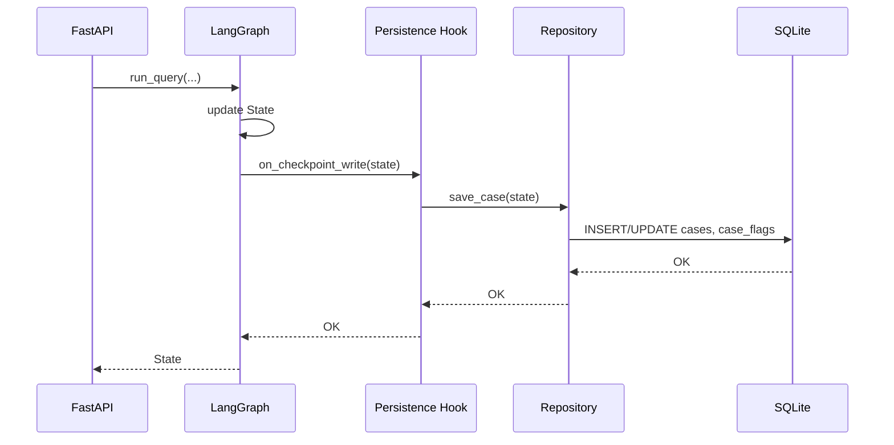
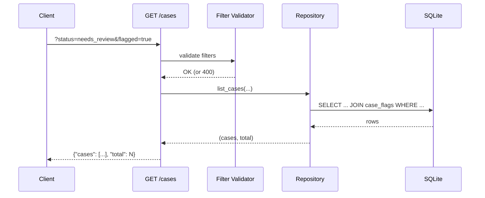
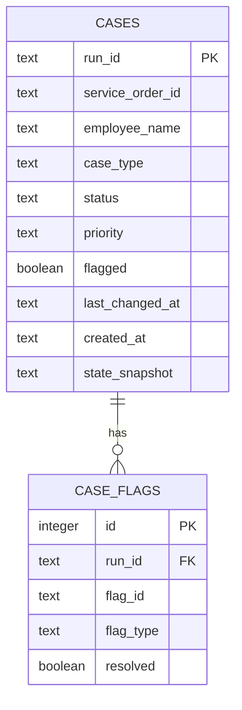

# High-Level Design — PER-209

**Reviewers can see, filter and count every case**

---

## Overview

This feature adds persistence and a REST API for case discovery, enabling reviewers and leads to see all cases, filter them by status/priority/flags, sort by wait time, and retrieve aggregate counts. Cases survive restarts with their last known state.

**Altitude:** Feature-level HLD for the entire PER-209 ticket (spanning backend storage, API, and query layer).

**Inherits from:** No parent spine; this is a standalone feature HLD.

---

## Architectural Decisions

### AD-1: SQLite file-based persistence for cases

**Binds:** Case state is stored in a SQLite database file located at `{project-root}/data/cases.db`. The schema is managed via migration scripts in `src/agents/persistence/migrations/`.

**Prevents:** Cases existing only in memory and disappearing on restart; multiple processes racing over Redis keys for persistence; unbounded memory usage as case count grows.

**Rule:** All case state mutations (status changes, flag additions, priority updates) write to SQLite synchronously before returning. Reads for list/filter/count queries go to SQLite. The in-memory checkpoint state remains separate and is not replaced by SQLite.

**Status:** `[ADOPTED]` — repo context shows no existing persistence; SQLite is a zero-dependency choice fitting the current stack.

---

### AD-2: REST API endpoints for list, filter, count

**Binds:**
- `GET /cases?status=<csv>&priority=<csv>&flagged=<bool>&flag_type=<type>&case_type=<csv>&sort=<field>&page=<int>&page_size=<int>` — returns paginated case list matching filters.
- `GET /cases/counts?by_status=<bool>&flagged=<bool>` — returns counts per status and flagged cases waiting.
- Response format for `/cases`: `{"cases": [<case objects>], "total": <int>, "page": <int>, "page_size": <int>}`.
- Response format for `/cases/counts`: `{"by_status": {"running": <int>, "needs_input": <int>, "needs_review": <int>, "done": <int>, "rejected": <int>, "failed": <int>}, "flagged_waiting": <int>}`.

**Prevents:** Callers guessing URL patterns; divergent filter syntax across endpoints; ambiguous pagination semantics.

**Rule:** All filter parameters accept comma-separated values (e.g. `status=running,needs_review`). Unknown values (invalid status, priority) return `400 Bad Request` with `{"error": "Invalid <field>: <value>. Allowed: [...]"}`. `sort` accepts `last_changed` (default, descending) and `wait_time` (ascending, only for `status=needs_review`). Default `page_size=25`, max `100`.

**Status:** `[ADOPTED]` — routes follow existing FastAPI patterns in `src/agents/runtime/server.py`.

**Assumption:** The ticket says "waiting for input" and "waiting for review" but the existing `State` in `src/agents/graph/states.py` uses `needs_input` and `needs_review`. The API will accept both forms in filters (mapping "waiting for input" → `needs_input`, "waiting for review" → `needs_review`) but will always return the normalized `needs_input`/`needs_review` in case objects. This keeps the implementation aligned with the existing codebase while supporting the ticket's language in API queries.

---

### AD-3: Case schema and indexed queries

**Binds:**
```sql
CREATE TABLE cases (
    run_id TEXT PRIMARY KEY,
    service_order_id TEXT,
    employee_name TEXT,
    case_type TEXT,
    status TEXT NOT NULL,
    priority TEXT,
    flagged BOOLEAN NOT NULL DEFAULT 0,
    last_changed_at TEXT NOT NULL,
    created_at TEXT NOT NULL,
    state_snapshot TEXT NOT NULL -- JSON blob of full State dict
);
CREATE INDEX idx_status ON cases(status);
CREATE INDEX idx_last_changed ON cases(last_changed_at DESC);
CREATE INDEX idx_flagged ON cases(flagged) WHERE flagged = 1;
```
Additionally:
```sql
CREATE TABLE case_flags (
    id INTEGER PRIMARY KEY AUTOINCREMENT,
    run_id TEXT NOT NULL,
    flag_id TEXT NOT NULL,
    flag_type TEXT NOT NULL,
    resolved BOOLEAN NOT NULL DEFAULT 0,
    FOREIGN KEY (run_id) REFERENCES cases(run_id) ON DELETE CASCADE
);
CREATE INDEX idx_case_flags_run_type ON case_flags(run_id, flag_type, resolved);
```

**Prevents:** Full-table scans on every filter query; inability to filter by unresolved flag type; losing the full State when reconstructing a case.

**Rule:** `status` values are `{'running', 'needs_input', 'needs_review', 'done', 'rejected', 'failed'}` (matching `State['status']` from `src/agents/graph/states.py`). `priority` values are `{'high', 'medium', 'low'}`. `last_changed_at` and `created_at` are ISO 8601 timestamps. `state_snapshot` holds the entire `State` dict as JSON for `/runs/{thread_id}` reconstruction and resume. Flag filtering joins `case_flags` where `resolved=0`.

**Status:** `[ADOPTED]` — schema matches the `State` structure in `src/agents/graph/states.py`.

---

### AD-4: Repository pattern for case queries

**Binds:** A new module `src/agents/persistence/repository.py` exposes:
```python
async def save_case(state: State) -> None
async def list_cases(
    statuses: list[str] | None,
    priorities: list[str] | None,
    flagged: bool | None,
    flag_type: str | None,
    case_types: list[str] | None,
    sort_by: str,
    page: int,
    page_size: int
) -> tuple[list[dict], int]
async def get_counts(by_status: bool, flagged: bool) -> dict
async def load_case(run_id: str) -> State | None
```

**Prevents:** SQL queries scattered across API handlers; tight coupling between API routes and database; test brittleness when schema evolves.

**Rule:** `save_case` is called at every `State` update (orchestrator, nodes completing, flags resolving). `list_cases` builds `WHERE` clauses from filters and `ORDER BY` from `sort_by`. `get_counts` uses `COUNT(*)` with `GROUP BY status`. All functions use `aiosqlite` for async I/O.

**Status:** `[ADOPTED]` — follows the async patterns in `src/agents/queue/` modules.

---

### AD-5: State updates trigger persistence

**Binds:** The LangGraph checkpointer write hook calls `save_case(state)` synchronously after each checkpoint write. A new `src/agents/runtime/persistence_hook.py` implements the hook and is registered in `src/agents/graph/build.py`.

**Prevents:** Cases landing in SQLite only at run completion; stale data when a run crashes mid-flight; pagination showing incomplete cases.

**Rule:** The hook extracts `run_id`, `service_order_id`, `employee_name` (via `backend.employee_name(state.get('service_order'))`), `case_type` (heuristic from `service_order` or `None`), `status`, `priority`, `flagged` (from `state['flagged']`), `last_changed_at` (current timestamp), and `state_snapshot` (full `state` as JSON). Flags in `state['flags']` are bulk-inserted into `case_flags` (delete existing first to avoid duplicates).

**Status:** `[ADOPTED]` — LangGraph checkpointers support write hooks; `src/agents/runtime/checkpointer.py` shows where to attach it.

---

### AD-6: Backward compatibility for single-case operations

**Binds:** `GET /runs/{thread_id}`, `POST /runs`, `POST /runs/{thread_id}/resume` remain unchanged. They read from the checkpointer as today. `repository.load_case(run_id)` returns the `State` from `cases.state_snapshot` for `/runs/{thread_id}` when the checkpointer is empty (restart scenario).

**Prevents:** Breaking existing case review workflows; forcing a data migration of in-flight runs.

**Rule:** The checkpointer is the source of truth for active runs. SQLite is the fallback for runs that existed before restart. New endpoints (`/cases`, `/cases/counts`) read only from SQLite and never invoke LangGraph.

**Status:** `[ADOPTED]` — no changes to `src/agents/runtime/server.py` single-case routes.

---

### AD-7: Filter validation at API entry

**Binds:** FastAPI route handlers validate `status`, `priority`, `flag_type`, `case_type` against allowed enums before calling `repository.list_cases`. Invalid values raise `HTTPException(400, detail="Invalid <field>: <value>. Allowed: [...]")`.

**Prevents:** SQL injection via unvalidated inputs; cryptic database errors surfacing to callers; silent filter mismatches (e.g. typo `'runnning'` matching nothing).

**Rule:** Allowed values:
- `status`: `{'running', 'needs_input', 'needs_review', 'done', 'rejected', 'failed'}` (also accepts `waiting for input` → `needs_input`, `waiting for review` → `needs_review` as synonyms)
- `priority`: `{'high', 'medium', 'low'}`
- `flag_type`: any string (checked against `case_flags.flag_type` in query)
- `case_type`: any string (no enum; derived from service order).

Comma-separated inputs are split and validated per-value.

**Status:** `[ADOPTED]` — follows FastAPI patterns already in `src/agents/runtime/server.py`.

---

### AD-8: Migration script for schema initialization

**Binds:** A new `src/agents/persistence/migrations/001_create_cases.sql` contains the `CREATE TABLE` and `CREATE INDEX` statements from AD-3. A migration runner in `src/agents/persistence/migrate.py` applies unapplied migrations on server startup (before FastAPI `@app.on_event("startup")`).

**Prevents:** Manual schema setup; version skew between dev/prod databases; broken queries from missing indexes.

**Rule:** Migration filenames are `{seq}_{description}.sql` (sequential integers). A `schema_version` table tracks applied migrations. Each migration runs in a transaction. Rollback is manual (not automated).

**Status:** `[ADOPTED]` — standard migration pattern; no prior migrations exist in the repo.

## Deferred Decisions

- **Full-text search** (AC explicitly out of scope).
- **Saved filters** (AC explicitly out of scope).
- **Export to CSV/JSON** (AC explicitly out of scope).
- **Real-time case list updates** (WebSocket/SSE) — not in AC; polling is sufficient.
- **Archival of old cases** — no retention policy specified; all cases persist indefinitely for now.
- **Audit log of case state changes** — not in AC; `last_changed_at` is sufficient.
- **Pagination cursor vs offset** — offset-based (`page` parameter) is simpler; cursors deferred unless performance issues arise.
- **Database connection pooling** — `aiosqlite` defaults are sufficient; pool tuning deferred until load testing.
- **Concurrency control** (optimistic locking) — LangGraph checkpointer handles in-memory concurrency; SQLite writes are serialized; no explicit row-level locking needed.

---

## Open Questions

1. **Case type derivation heuristic:** How is `case_type` extracted from `service_order`? Is it `service_order['caseType']` verbatim, or does it map to a normalized set? *(Answer determines filter accuracy for AC7.)*
2. **Flag type normalization:** Are flag types (`netPayMismatch`, `missingData`, etc.) hardcoded enums or freeform strings? *(Answer affects filter validation in AD-7.)*
3. **"Waiting for review" vs "needs_review":** AC uses both terms; are they the same status? *(Assume `needs_review` for now; verify in requirements.)*
4. **Wait time calculation:** How is "how long they have been waiting" computed for AC7? Is it `last_changed_at` when status became `needs_review`, or a separate timestamp? *(No `waiting_since` field in current schema; may need migration amendment.)*

---

## Diagrams

### Case Persistence Flow



### Case List Query Flow



### Database Schema



---

## Risks and Mitigations

| Risk | Impact | Mitigation |
|------|--------|------------|
| SQLite write contention under high load | API writes block on DB lock | Use `aiosqlite` with `timeout` param; defer to Postgres if contention becomes measurable |
| Checkpointer and SQLite state diverge | Stale data in list view | Persistence hook runs synchronously in checkpoint path; write failure fails the run |
| Large `state_snapshot` blobs slow queries | Slow `/cases` response | Index only on metadata columns; `state_snapshot` is retrieved only for single-case `/runs/{thread_id}` |
| Migration failures on startup crash server | Downtime | Migration runner logs errors and exits cleanly; manual rollback procedure documented |
| Filter injection (malicious `flag_type`) | Data leak or corruption | All filters validated at API layer; parameterized SQL queries prevent injection |

---

## Verification

Each AC maps to a verification approach:

- **AC1:** Query `/cases` with no filters; verify response includes cases with all six statuses.
- **AC2:** Check each case object in response has `service_order_id`, `employee_name`, `case_type`, `status`, `priority`, `flagged`, `last_changed_at`.
- **AC3:** Query `/cases`; verify default sort is `last_changed_at DESC`.
- **AC4:** Query `/cases` with no `page_size`; verify 25 items. Query with `page_size=50`; verify 50 items. Query with `page_size=150`; verify `400 Bad Request`.
- **AC5:** Query `/cases?status=running,done`; verify only those statuses appear.
- **AC6:** Query `/cases?priority=high`; verify only high-priority cases appear.
- **AC7:** Query `/cases?flagged=true`; verify all returned cases have `flagged=true`.
- **AC8:** Query `/cases?case_type=Offboarding`; verify only that type appears.
- **AC9:** Query `/cases?status=needs_review&flagged=true`; verify intersection of both filters.
- **AC10:** Query `/cases?flag_type=netPayMismatch`; verify only cases with unresolved `netPayMismatch` flags appear (join `case_flags` where `resolved=0`).
- **AC11:** Query `/cases?status=needs_review&sort=wait_time`; verify cases ordered by wait time ascending (requires `waiting_since` field or `last_changed_at` heuristic — see Open Question 4).
- **AC12:** Query `/cases/counts?by_status=true&flagged=true`; verify counts returned without loading case list.
- **AC13:** Restart server; verify cases created before restart still appear in `/cases` with same status (read from SQLite).
- **AC14:** Query `/cases?status=invalid_status`; verify `400 Bad Request` with message listing allowed values.
- **AC15:** POST `/runs/{thread_id}/resume` (existing endpoint); verify it works unchanged.

---

## Dependencies

- **External:** None (SQLite is bundled with Python).
- **Internal:**
  - `src/agents/graph/states.py` — `State` structure defines persisted fields.
  - `src/agents/runtime/checkpointer.py` — hook attachment point.
  - `src/agents/runtime/server.py` — new routes added here.
  - `src/agents/runtime/backend.py` — `employee_name` helper reused.
  - `pyproject.toml` — add `aiosqlite` dependency.

---

## Notes

- **No language-specific syntax prescribed:** The HLD specifies outcomes (JSON response formats, SQL schema, API contracts) without Python-specific syntax (no f-strings vs `"a" + b` choice made here).
- **File paths match repo tree:** All new files (`src/agents/persistence/repository.py`, `src/agents/persistence/migrate.py`, `src/agents/persistence/migrations/001_create_cases.sql`, `src/agents/runtime/persistence_hook.py`) are under existing `src/agents/` structure, consistent with `repo-tree/agent`.
- **Stack consistency:** Python + FastAPI + aiosqlite (async SQLite) matches the existing stack (`src/agents/runtime/server.py` already uses FastAPI; async patterns are pervasive in `src/agents/queue/`).
- **Child ticket coverage:** The single proposed ticket (`Case list API with filtering, sorting, and counts`) covers all ACs. The breakdown step will split this into backend (persistence, repository, API routes) and any frontend integration stories. Each story will detail schema migration, repository functions, route handlers, and filter/sort query construction per the LLD focus guidance.
