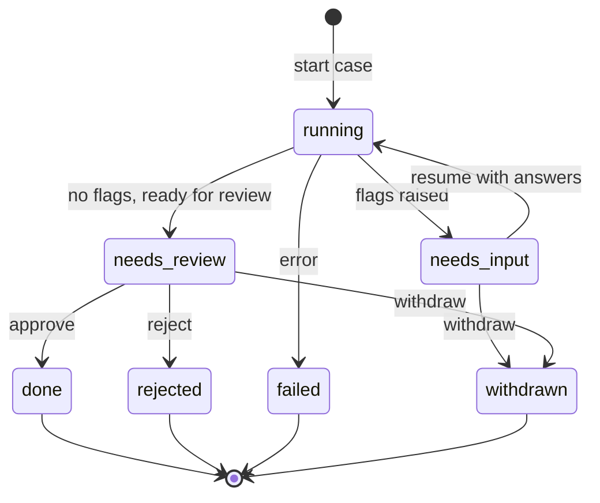

# High-Level Design — PER-222

**Status:** Draft  
**Source:** Requirements PER-222  
**Epic:** _(none — standalone ticket)_

---

## Overview

Adds a withdrawal operation for paused cases, allowing reviewers to cleanly stop a case waiting for flag answers or final review, with a mandatory reason. The operation affects the domain model (case state transitions, history recording), API (new endpoint), CLI (new command), queue handling (resume message handling), persistence (state and history storage), and console integration (activity feed notification).

---

## Architecture Decisions

### AD-1: Withdrawn is a terminal case state

**Binds:** Case state enumeration and valid state transitions  
**Prevents:** A withdrawn case being resumed, approved, rejected, re-run, or withdrawn again  
**Rule:**

- Add `withdrawn` to the case status enumeration (alongside `running`, `needs_input`, `needs_review`, `done`, `rejected`, `failed`).
- Valid transitions to `withdrawn`: from `needs_input` (waiting for flag answers) or `needs_review` (waiting for final review).
- Once `withdrawn`, no outbound transitions are allowed. All operations that mutate case state (resume, approve, reject, start, withdraw again) must check the current state and refuse if `withdrawn`.

**Rationale:** AC 4, 6, 9 require withdrawn cases to be terminal; a new state makes enforcement explicit and consistent across all operations.

---

### AD-2: Withdrawal requires a non-empty trimmed reason, capped at 500 characters

**Binds:** API request validation, CLI argument validation, persistence schema  
**Prevents:** Withdrawn cases without an audit trail of why they were stopped  
**Rule:**

- The withdrawal operation accepts a `reason` string parameter.
- Validation: trim whitespace (spaces, tabs, line breaks); reject if empty after trimming or exceeds 500 characters.
- Persist the exact trimmed reason with the case's final state.

**Rationale:** AC 2 mandates a reason and specifies the empty/whitespace refusal and 500-character limit.

---

### AD-3: Withdrawal operation is synchronous (does not re-run agents or execute payroll)

**Binds:** Operation implementation (no agent dispatch, no queue work enqueued)  
**Prevents:** Withdrawal from triggering side effects beyond state and history updates  
**Rule:**

- The withdrawal operation performs only:
  1. State validation (current state must be `needs_input` or `needs_review`)
  2. State transition to `withdrawn`
  3. Persistence update (status, reason, timestamp)
  4. History entry append (reviewer, timestamp, reason)
  5. Console notification dispatch (best-effort, non-blocking)
- No agent nodes are invoked, no payroll packages are generated, no flags are re-evaluated.

**Rationale:** AC 3 specifies no agent re-runs and no payroll action; the operation is administrative, not operational.

---

### AD-4: Withdrawal records a history entry with reviewer, timestamp, and reason

**Binds:** Case history schema and persistence  
**Prevents:** Lost audit trail of who withdrew the case and why  
**Rule:**

- Append a history entry of type `withdrawn` to the case's history list, containing:
  - `type: "withdrawn"`
  - `by: <reviewer identifier>` (the authenticated user making the request)
  - `at: <ISO 8601 timestamp>` (the UTC time of withdrawal)
  - `reason: <trimmed reason string>`
- The history entry is the final entry in the case's history (no entries are added after withdrawal).

**Rationale:** AC 5 requires the case's history to end with the withdrawal details.

---

### AD-5: Withdrawal is idempotent (repeated calls after withdrawal return the same error)

**Binds:** API and CLI behavior when called on an already-withdrawn case  
**Prevents:** Ambiguity about what happens when a client retries a withdrawal request  
**Rule:**

- If the case is already `withdrawn`, return a 409 Conflict (API) or an error message (CLI) stating "Case was withdrawn" with the existing reason and timestamp.
- Do not modify the case's state, history, or reason; treat the request as a no-op with an error response.

**Rationale:** AC 6 requires refusing a second withdrawal; returning the existing withdrawal details supports client reconciliation without silent failure.

---

### AD-6: Queue resume messages for withdrawn cases are no-ops with status recorded

**Binds:** Queue message handler logic for `resume_service_order` jobs  
**Prevents:** A queued resume from accidentally restarting a withdrawn case  
**Rule:**

- When a `resume_service_order` job dequeues, load the case's current state before processing.
- If the state is `withdrawn`, skip all resume logic (no graph invocation), write a queue status entry indicating `withdrawn`, and mark the job as successfully completed.
- The queue status message format: `{"status": "withdrawn", "reason": "<reason>", "withdrawn_at": "<timestamp>"}`.

**Rationale:** AC 11 requires graceful handling of resume messages arriving after withdrawal; recording the status allows queue monitoring to detect and reconcile these no-ops.

---

### AD-7: Console notification of withdrawal is best-effort

**Binds:** Console integration responsibility and error handling  
**Prevents:** Withdrawal operation from failing due to console unavailability  
**Rule:**

- After persisting the withdrawal, dispatch an activity feed event to the console's backend (via `report_progress` or equivalent):
  - Event type: `"case_withdrawn"`
  - Payload: `{"employee_name": <name or null>, "reason": "<reason>", "withdrawn_at": "<timestamp>"}`
- If the console notification fails (network error, timeout, 5xx), log the failure but do not roll back the withdrawal or return an error to the caller.

**Rationale:** AC 12 specifies the console receives a "Case withdrawn" event but the withdrawal proceeds even if the console is unreachable; this is a fire-and-forget integration.

---

## Component Interaction

### Withdrawal Endpoint (API)

**Path:** `POST /runs/{thread_id}/withdraw`  
**Request body:**

```json
{
  "reason": "Duplicate of SO-1003"
}
```

**Response (success, 200):**

```json
{
  "status": "withdrawn",
  "reason": "Duplicate of SO-1003",
  "withdrawn_at": "2026-10-15T14:32:00Z"
}
```

**Response (validation error, 400):**

```json
{
  "error": "Reason is required and cannot be empty"
}
```

or

```json
{
  "error": "Reason exceeds 500 characters"
}
```

**Response (invalid state, 409):**

```json
{
  "error": "Case is running, wait until it pauses"
}
```

or

```json
{
  "error": "Case is done, cannot withdraw"
}
```

or

```json
{
  "error": "Case was withdrawn on 2026-10-14T10:00:00Z: Duplicate of SO-1003"
}
```

**Response (not found, 404):**

```json
{
  "error": "Case not found"
}
```

**Implementation notes:**

- Extract `thread_id` from path, `reason` from body.
- Load case state from checkpointer (see Persistence Integration).
- Validate state transition (AD-1) and reason (AD-2).
- Write withdrawal state and history entry (AD-4).
- Dispatch console notification (AD-7).
- Return success response.

---

### Withdrawal Command (CLI)

**Command:** `withdraw-case`  
**Usage:**

```bash
python -m agents.cli withdraw-case <thread_id> --reason "Duplicate of SO-1003"
```

**Output (success):**

```
Case <thread_id> withdrawn: Duplicate of SO-1003
Withdrawn at: 2026-10-15T14:32:00Z
```

**Output (error):**

```
Error: Reason is required and cannot be empty
```

or

```
Error: Case is running, wait until it pauses
```

or

```
Error: Case not found
```

**Implementation notes:**

- Parse `thread_id` and `--reason` arguments.
- Validate reason locally (trim, non-empty, ≤500 chars).
- Call a shared withdrawal service function (see Domain Logic).
- Print success or error message to stdout/stderr.

---

### Queue Resume Handler Integration

**Affected code:** `src/agents/queue/orders.py`, `resume_service_order` function

**Current behavior:**

- Dequeues a `resume_service_order` job.
- Loads case state from checkpointer.
- Invokes the graph to continue processing.

**New behavior (AD-6):**

- After loading case state, check `status` field.
- If `status == "withdrawn"`:
  - Skip graph invocation.
  - Write queue status to Redis: `status_key(thread_id)` → `{"status": "withdrawn", "reason": "<reason>", "withdrawn_at": "<timestamp>"}`.
  - Mark job as successful (no retry).
  - Log the no-op: `Case {thread_id} already withdrawn, resume ignored`.

---

### Persistence Integration

**Affected code:** `src/agents/runtime/checkpointer.py`, state loading/saving

**State schema changes:**

- Add `withdrawn_at: str | None` field to `State` TypedDict (ISO 8601 timestamp, `None` if not withdrawn).
- Add `withdrawn_by: str | None` field to `State` TypedDict (reviewer identifier, `None` if not withdrawn).
- Add `withdrawal_reason: str | None` field to `State` TypedDict (trimmed reason, `None` if not withdrawn).

**History entry schema:**

- Append to `State["steps"]` list (or a dedicated `history` field if one is introduced):

```python
{
  "type": "withdrawn",
  "by": "<reviewer_id>",
  "at": "<ISO 8601 timestamp>",
  "reason": "<trimmed reason>"
}
```

**Checkpoint write:**

- When transitioning to `withdrawn`, update `status`, `withdrawn_at`, `withdrawn_by`, `withdrawal_reason`, and append the history entry.
- Commit checkpoint to the checkpointer (in-memory, sqlite, or postgresql depending on deployment).

**Checkpoint read:**

- All operations that load case state (API, CLI, queue handlers) must read these fields to enforce state transition rules.

---

### Console Notification Integration

**Affected code:** `src/agents/runtime/backend.py`, `report_progress` function or a new `report_withdrawal` function

**Current behavior:**

- `report_progress` sends lifecycle and step events to the console backend.

**New behavior (AD-7):**

- Add a `report_withdrawal` function or extend `report_progress` to handle withdrawal events:

```python
async def report_withdrawal(
    thread_id: str,
    reason: str,
    withdrawn_at: str,
    employee: str | None
) -> None:
    event = {
        "kind": "case_withdrawn",
        "employee_name": employee,
        "reason": reason,
        "withdrawn_at": withdrawn_at
    }
    try:
        # POST to console backend's activity feed endpoint
        await _post_to_console(thread_id, [event])
    except Exception as e:
        # Log failure, do not raise
        logger.warning(f"Console notification failed for withdrawal: {e}")
```

**Console backend contract (assumed):**

- Accepts activity feed events with `kind: "case_withdrawn"`.
- Displays "Case withdrawn" in the activity feed with employee name (if available) and reason.

---

## Domain Logic

### Shared Withdrawal Service Function

**Location:** `src/agents/runtime/withdrawal.py` (new file)

**Function signature:**

```python
async def withdraw_case(
    thread_id: str,
    reason: str,
    reviewer_id: str,
    *,
    checkpointer_kind: str = "memory",
    db_path: Path | None = None
) -> dict[str, Any]:
    """
    Withdraw a paused case with a reason.
    
    Returns:
        {"status": "withdrawn", "reason": "...", "withdrawn_at": "..."}
        
    Raises:
        ValueError: If reason is invalid (empty or >500 chars).
        InvalidStateError: If case is not in a withdrawable state.
        CaseNotFoundError: If case does not exist.
    """
```

**Implementation steps:**

1. Validate reason: trim whitespace, check non-empty and ≤500 characters.
2. Load case state from checkpointer.
3. Check case exists (raise `CaseNotFoundError` if not).
4. Check current `status` field:
   - If `status == "running"`: raise `InvalidStateError("Case is running, wait until it pauses")`.
   - If `status in ("done", "rejected", "failed")`: raise `InvalidStateError(f"Case is {status}, cannot withdraw")`.
   - If `status == "withdrawn"`: raise `InvalidStateError(f"Case was withdrawn on {withdrawn_at}: {withdrawal_reason}")` (AD-5).
   - If `status not in ("needs_input", "needs_review")`: raise `InvalidStateError(f"Case status {status} is not withdrawable")`.
5. Transition to `withdrawn`:
   - Set `status = "withdrawn"`.
   - Set `withdrawn_at = <current UTC timestamp>`.
   - Set `withdrawn_by = reviewer_id`.
   - Set `withdrawal_reason = <trimmed reason>`.
   - Append history entry (AD-4).
6. Write checkpoint.
7. Dispatch console notification (AD-7, best-effort).
8. Return `{"status": "withdrawn", "reason": reason, "withdrawn_at": withdrawn_at}`.

---

## API Routes

**Existing routes (no changes):**

- `POST /runs` — create a new run
- `POST /runs/{thread_id}/resume` — resume with flag answers or review decision
- `GET /runs/{thread_id}` — get case snapshot

**New route:**

- `POST /runs/{thread_id}/withdraw` — withdraw a paused case (see Withdrawal Endpoint above)

---

## CLI Commands

**Existing commands (no changes):**

- Run query: `python run_so.py` or `python -m agents.runtime.runner`
- Resume: handled via API or internal tooling

**New command:**

- `python -m agents.cli withdraw-case <thread_id> --reason "<reason>"` (see Withdrawal Command above)

**Implementation note:** The CLI module may need to be created if it does not exist; alternatively, the command can be added to `run_so.py` or a new `run_withdrawal.py` script.

---

## State Transitions Diagram



---

## Risks and Mitigations

### Risk 1: Race condition between queue resume and withdrawal

**Scenario:** A resume job is dequeued at the same time a reviewer withdraws the case via API or CLI.

**Mitigation:**

- The checkpointer's transactional semantics (if using sqlite or postgresql) ensure that the state write is atomic.
- The resume handler checks the state after loading (AD-6) and skips work if `status == "withdrawn"`.
- If the withdrawal happens after the resume handler reads the state but before it writes back, the resume will overwrite the withdrawal; to prevent this, the withdrawal operation must use a checkpointer transaction or optimistic locking (e.g. compare-and-swap on a version field). **This requires investigation of the checkpointer's API and may need a checkpoint version field added to `State`.**

**Open question:** Does the current checkpointer support optimistic locking or transactions? If not, recommend adding a `version: int` field to `State` and using compare-and-swap logic in both withdrawal and resume operations.

---

### Risk 2: Console notification failure is silent to the user

**Scenario:** The console backend is down or unreachable when a case is withdrawn; the reviewer sees a success response but the activity feed is never updated.

**Mitigation:**

- AD-7 establishes best-effort semantics: the withdrawal succeeds regardless of console availability.
- Log all notification failures at `WARNING` level with enough detail for ops to reconcile (thread_id, timestamp, reason).
- Consider a follow-up enhancement: a background job that retries failed console notifications from a queue or outbox table.

---

### Risk 3: Withdrawn cases clutter the UI or monitoring dashboards

**Scenario:** Withdrawn cases accumulate in the case list without clear filtering or archival.

**Mitigation:**

- This is out of scope for this ticket (per the ticket's "Out of scope" section: "changes to the console itself").
- Document the `withdrawn` state in the console's case list API contract so the console team can add filtering (e.g. "Hide withdrawn cases" toggle).

---

## Open Questions

1. **Checkpoint locking:** Does the checkpointer support optimistic locking or transactions to prevent race conditions between withdrawal and resume? If not, should a `version` field be added to `State`?
2. **Reviewer authentication:** How is the `reviewer_id` determined in the API and CLI contexts? Is it extracted from an authentication token (API) or passed as a CLI argument?
3. **Console backend endpoint:** What is the exact URL and payload format for the console's activity feed notification endpoint? Is `report_progress` the right integration point or should a new function be added?
4. **CLI module location:** Should the withdrawal CLI command live in a new `src/agents/cli.py` module, be added to `run_so.py`, or exist as a standalone script?

---

## Deferred Decisions

- **Who is allowed to withdraw:** Authorization and role-based access control (RBAC) for the withdrawal operation is out of scope. The current implementation assumes all authenticated users can withdraw any case. A future ticket should add role checks (e.g. only admins or case owners can withdraw).
- **Notification retries:** The console notification is best-effort with no retries. A future enhancement could add a retry queue or outbox pattern for failed notifications.
- **Undo withdrawal:** The ticket explicitly excludes undoing a withdrawal. If this is needed in the future, a new operation (e.g. `restore-case`) would need to be designed with its own state transition rules.
- **Stopping running cases:** The ticket excludes stopping a case while it is still `running`. This would require a more invasive change (e.g. graph cancellation, agent interrupt handling) and is deferred to a future enhancement.

---

## Testing Considerations

- **State transition validation:** Unit tests for every state transition rule (valid transitions to `withdrawn`, invalid transitions rejected with appropriate errors).
- **Reason validation:** Parameterized tests for reason validation (empty, whitespace-only, exactly 500 chars, over 500 chars).
- **History recording:** Verify the history entry is appended with correct fields and is the final entry.
- **Persistence across restarts:** Integration test that withdraws a case, restarts the service (or re-opens the checkpointer), and verifies the case is still `withdrawn` with all fields intact.
- **Queue resume no-op:** Integration test that enqueues a resume job after withdrawing a case, then verifies the resume handler skips work and writes the correct queue status.
- **Console notification failure:** Mock the console backend to fail, verify the withdrawal still succeeds and the failure is logged.
- **Idempotency:** Call the withdrawal operation twice on the same case, verify the second call returns the same error and does not modify state.
- **CLI command:** End-to-end test invoking the CLI command with various arguments and verifying output and state changes.

---

## Out of Scope (Confirmed from Ticket)

- Stopping a case while it is running (status `running`)
- Stopping a case still waiting in the queue to start (before first graph invocation)
- Undoing a withdrawal (restoring a withdrawn case to its previous state)
- Authorization rules (who is allowed to withdraw)
- Retry or durable delivery of console notifications beyond the initial best-effort attempt
- Changes to the console itself (UI, filtering, display logic)
