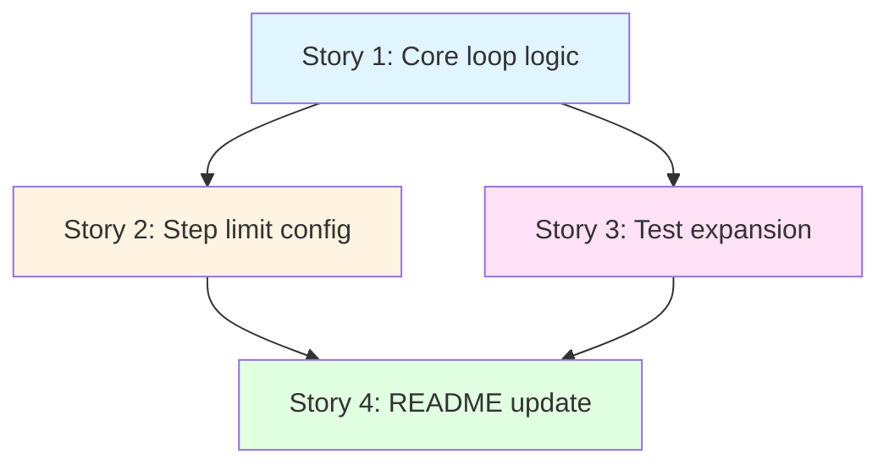

# Breakdown — PER-56

**made from:** requirements.md, hld.md, review_feedback.md  
**source:** scrum_master  
**altitude:** feature

---

## Overview

This breakdown splits the multi-step tool orchestration feature into four ordered implementable stories. Each story is independently testable and builds toward the final acceptance criteria. The core loop logic, environment variable parsing, test expansion, and README documentation are separated into distinct stories to enable incremental implementation and validation.

**Change from prior version:** The HTTP endpoint is now `/query_given` (was `/query`). All contracts, specifications, route handlers, test fixtures, and documentation reference `/query_given`.

---

## Story dependencies



**Build order:** Story 1 → Story 2 → Story 3 → Story 4

**Rationale:**
- Story 1 (core loop) is the foundation; Stories 2 and 3 depend on it.
- Story 2 (env var parsing) and Story 3 (test expansion) are independent of each other.
- Story 4 (README) documents the complete feature, so it runs last.

---

## Stories

### Story 1: Implement bounded multi-step tool loop in Orchestrator

**Repo:** `agent`

**Description:**

Replace the single tool-execution block in `Orchestrator.handle_query` with a bounded loop that allows up to `max_steps` tool rounds. The LLM can call tools, see results, and call more tools until it produces a text answer or reaches the step limit. When the limit is reached, make one final `tools=None` call; if that does not return text, raise `RuntimeError`. Preserve all existing tool-validation and execution logic (unknown-tool and missing-field `ValueError`s, `id` uppercasing, 10s timeout). Log each step at INFO level with the step number and tool names called.

**Covers:** FR-1 (loop), FR-2 (step limit enforcement), FR-4 (logging), NFR-1 (no MCP changes), NFR-2 (backward compatibility)

**Files modified:**
- `app/agent/orchestrator.py` (~40 lines changed)
  - Add `max_steps: int = 5` parameter to `__init__`, store as `self.max_steps`.
  - Replace single tool-execution block with `while step < self.max_steps:` loop.
  - Add step counter (`step = 0`), increment after each `tool_use` response.
  - Add `logger.info(f"Step {step}: executed tools {tool_names}")` after tool execution.
  - Add final `llm_client.infer(messages, tools=None)` call when `step == max_steps`.
  - Raise `RuntimeError("agent exceeded max_steps without an answer")` if final call does not return non-empty text.
  - Remove old `tools=None` synthesis call and "synthesis loop detected" guard.

**After:** (none)

**Verification Approach:**

Unit test with mocked `llm_client` and `mcp_client`:
- **Test 1 (AC-1):** Direct text answer: one `infer` call, no tool calls → text returned (existing behavior, 1 test case).
- **Test 2 (AC-2):** Two-step tool chain: `tool_use` → `tool_use` → `text` → text returned, MCP called twice, second `infer` includes first tool result (1 test case).
- **Test 3 (AC-3):** Step limit with answer: `max_steps=2`, two `tool_use` calls, final `tools=None` returns text → text returned (1 test case).
- **Test 4 (AC-4):** Step limit without answer: `max_steps=2`, all calls return `tool_use` → `RuntimeError` raised (1 test case).
- **Test 5 (AC-5):** Unknown tool on step 2: first call valid, second call unknown tool → `ValueError` raised before third LLM call (1 test case).

**Total test count:** 5 unit tests in `tests/test_orchestrator.py`.

**Notes:**

- Hardcode `max_steps=5` in `__init__` for this story; Story 2 will wire it to the env var.
- Existing tool validation and execution logic is reused verbatim inside the loop.
- Message list grows as `[user] → [user, asst, user] → [user, asst, user, asst, user] → ...` (each tool round adds two messages).
- Step counter starts at 0; a direct text answer never increments it.
- Log line format: `"Step 1: executed tools ['get_employee']"` (tool names extracted from `tool_calls` list).

---

### Story 2: Add AGENT_MAX_STEPS environment variable parsing and update endpoint to /query_given

**Repo:** `agent`

**Description:**

Read `AGENT_MAX_STEPS` from the environment in `run_server`, validate it as a positive integer, and pass it to the `Orchestrator` constructor. If the value is invalid (non-integer, non-positive, or empty), log a warning and use the default value `5`. This allows operators to tune the step limit per deployment without code changes. Additionally, update the HTTP route handler from `/query` to `/query_given` per review feedback.

**Covers:** FR-3 (step limit configuration), endpoint change per review_feedback.md

**Files modified:**
- `app/run_server.py` (~12 lines changed)
  - Add `import os` and `import logging` at top (if not already present).
  - Parse `AGENT_MAX_STEPS` from `os.environ.get("AGENT_MAX_STEPS", "")` before instantiating `Orchestrator`.
  - Validate: if non-empty, parse as `int`; if `<= 0`, raise `ValueError`. Catch `ValueError`/`TypeError` and log warning, use default `5`.
  - Pass `max_steps=<parsed_value>` to `Orchestrator(...)` constructor.
  - Update HTTP route handler from `@app.route("/query", methods=["POST"])` to `@app.route("/query_given", methods=["POST"])`.

**After:** Story 1 (depends on `max_steps` parameter existing in `Orchestrator.__init__`)

**Verification Approach:**

Unit test with mocked `os.environ` and `Orchestrator` constructor:
- **Test 6 (AC-6):** Valid value `"3"` → `Orchestrator` instantiated with `max_steps=3`, no warning logged (1 test case).
- **Test 7 (AC-6):** Invalid values (`"foo"`, `"-1"`, `""`, `"3.5"`) → `Orchestrator` instantiated with `max_steps=5`, warning logged (4 sub-cases in 1 test case).
- **Test 8 (new):** HTTP endpoint path: `POST /query_given` succeeds, `POST /query` returns 404 (1 test case).

**Total test count:** 3 unit tests in `tests/test_http_server.py` (or `tests/test_run_server.py`).

**Notes:**

- Parsing logic (see requirements.md FR-3) uses `try/except (ValueError, TypeError)` to catch both `int()` parse failures and comparison failures.
- Log message: `"Invalid AGENT_MAX_STEPS, using default 5"`.
- Env var absent (`""`) is treated as "use default 5" without warning; only invalid *present* values trigger warning.
- Route handler path change: `@app.route("/query_given", methods=["POST"])`.

---

### Story 3: Update orchestrator tests for multi-step behavior

**Repo:** `agent`

**Description:**

Expand `tests/test_orchestrator.py` with test cases covering the bounded loop, step limit, and multi-step tool chains. Remove or update the existing test that asserts the old "synthesis loop detected" error, since that guard no longer exists. Ensure all tests pass with `python -m pytest -q`.

**Covers:** AC-1 (direct text), AC-2 (two-step chain), AC-3 (step limit with answer), AC-4 (step limit without answer), AC-5 (unknown tool on step 2), AC-7 (old test removed)

**Files modified:**
- `tests/test_orchestrator.py` (~120 lines added/changed)
  - Add test case for direct text answer (existing behavior, may already exist — update assertions if needed).
  - Add test case for two-step tool chain: mock two `infer` calls, assert MCP called once, second call's `messages` includes first tool result.
  - Add test case for step limit with answer: `max_steps=2`, two tool rounds, final `tools=None` returns text.
  - Add test case for step limit without answer: `max_steps=2`, all calls return `tool_use` → `RuntimeError` raised.
  - Add test case for unknown tool on step 2: first call valid, second call unknown tool → `ValueError` raised.
  - Find and remove (or update) existing test that asserts `RuntimeError("... synthesis loop detected")`.

**After:** Story 1 (depends on loop logic existing in `Orchestrator.handle_query`)

**Verification Approach:**

All test cases in `tests/test_orchestrator.py` pass:
- **Test 1 (AC-1):** Direct text answer → 1 `infer` call, 0 MCP calls, text returned (1 assertion set).
- **Test 2 (AC-2):** Two-step chain → 2 `infer` calls, 1 MCP call, second call's `messages` has 3 entries, text returned (4 assertion sets).
- **Test 3 (AC-3):** Step limit with answer → 3 `infer` calls (2 with tools, 1 with `tools=None`), 2 MCP calls, text returned (3 assertion sets).
- **Test 4 (AC-4):** Step limit without answer → 3 `infer` calls, 2 MCP calls, `RuntimeError` raised (3 assertion sets).
- **Test 5 (AC-5):** Unknown tool on step 2 → 2 `infer` calls, 1 MCP call, `ValueError` raised (3 assertion sets).
- **Test 9 (AC-7):** Old synthesis-loop test removed or updated → `pytest` exits 0 (1 assertion set).

**Total test count:** 6 test cases (5 new behaviors + 1 cleanup).

**Notes:**

- Use `unittest.mock` or `pytest-mock` to mock `llm_client.infer` and `mcp_client.execute_tools`.
- Mock return values are canned dicts: `{"type": "text", "content": "..."}` or `{"type": "tool_use", "content": [{"id": "...", "name": "...", "input": {...}}]}`.
- Test 2 (two-step chain) asserts on `messages` argument passed to second `infer` call: should be `[user, asst, user]` (3 entries).
- Test 5 (unknown tool) asserts `ValueError` is raised *before* a third LLM call (only 2 `infer` calls, not 3).

---

### Story 4: Document AGENT_MAX_STEPS, multi-step capability, and /query_given endpoint in README

**Repo:** `agent`

**Description:**

Add `AGENT_MAX_STEPS` to the environment-variables table in the README with its description and default value. Add one sentence to the README describing the multi-step tool-use capability. Update all API endpoint documentation and examples from `/query` to `/query_given`. This ensures operators and developers know about the new configuration option, feature, and endpoint path.

**Covers:** AC-8 (README updated), endpoint path documentation

**Files modified:**
- `README.md` (~8 lines added)
  - Add row to environment-variables table:
    ```
    | `AGENT_MAX_STEPS` | Maximum tool-use steps before forcing a final answer | `5` |
    ```
  - Add sentence to "Features" section (or new "Capabilities" section):
    > The orchestrator supports multi-step tool use, allowing the LLM to call tools, see results, and call additional tools until it produces an answer or reaches the step limit.
  - Update all endpoint references from `/query` to `/query_given` in API documentation, curl examples, and any route descriptions.

**After:** Story 2, Story 3 (both Stories 2 and 3 must be complete for the feature to be fully documented)

**Verification Approach:**

Manual review of `README.md` diff:
- **Check 1:** Environment-variables table includes `AGENT_MAX_STEPS` row with description and default `5` (1 manual check).
- **Check 2:** Capability description sentence present in README (1 manual check).
- **Check 3:** All endpoint references use `/query_given` (not `/query`), including curl examples and route descriptions (1 manual check).

**Total test count:** 3 manual checks (no automated tests).

**Notes:**

- If an environment-variables table does not yet exist in the README, create one with headers: `| Variable | Description | Default |`.
- Place the capability description sentence in an existing "Features" or "Usage" section; if none exists, create a "Capabilities" section.
- Use consistent capitalization and punctuation with the rest of the README.
- Update all curl examples to reference `/query_given`:
  ```bash
  curl -X POST http://localhost:8000/query_given \
    -H "Content-Type: application/json" \
    -d '{"query": "..."}'
  ```

---

## Acceptance criteria summary

All acceptance criteria from requirements.md are covered across the four stories:

- **AC-1 (direct text):** Story 1 Test 1, Story 3 Test 1
- **AC-2 (two-step chain):** Story 1 Test 2, Story 3 Test 2
- **AC-3 (step limit with answer):** Story 1 Test 3, Story 3 Test 3
- **AC-4 (step limit without answer):** Story 1 Test 4, Story 3 Test 4
- **AC-5 (unknown tool on step 2):** Story 1 Test 5, Story 3 Test 5
- **AC-6 (AGENT_MAX_STEPS parsing):** Story 2 Tests 6–7
- **AC-7 (old test removed):** Story 3 Test 9
- **AC-8 (README updated):** Story 4 manual checks 1–3
- **Endpoint change to /query_given:** Story 2 Test 8, Story 4 Check 3

**Total test count across all stories:** 5 (Story 1) + 3 (Story 2) + 6 (Story 3) + 0 (Story 4, manual only) = **14 automated tests + 3 manual checks**.

---

## Allowed paths

All file paths must exist in the `agent` repo or be created as part of the story:

- `app/agent/orchestrator.py` (modified in Story 1)
- `app/run_server.py` (modified in Story 2)
- `tests/test_orchestrator.py` (modified in Stories 1 and 3)
- `tests/test_http_server.py` (modified in Story 2; if this file does not exist, use `tests/test_run_server.py` or create it)
- `README.md` (modified in Story 4)

No files outside the `agent` repo are modified. No new external dependencies are added.

---

## Out of scope

- Conversation memory across `/query_given` requests.
- Streaming responses.
- Any changes to `mcp_client.py` or the MCP server.
- Per-query timeout (existing per-tool 10s timeout is reused).
- Adaptive step limit (fixed per deployment via env var).

---

## Open questions

None.

---

## Dependencies

- **Existing:** `llm_client.infer(messages, tools)` (unchanged).
- **Existing:** `mcp_client.execute_tools(tool_calls)` (unchanged).
- **Existing:** `Orchestrator` class and `handle_query` method (modified in Story 1).
- **New:** `run_server` parses `AGENT_MAX_STEPS` and passes to `Orchestrator` (Story 2).
- **New:** HTTP route handler uses `/query_given` endpoint path (Story 2).

No new external dependencies.

---

## Verification summary

| Story | Automated tests | Manual checks |
|-------|-----------------|---------------|
| Story 1 | 5 unit tests | 0 |
| Story 2 | 3 unit tests | 0 |
| Story 3 | 6 unit tests | 0 |
| Story 4 | 0 | 3 manual checks |
| **Total** | **14 unit tests** | **3 manual checks** |

All tests must pass with `python -m pytest -q` before the feature is considered complete.
