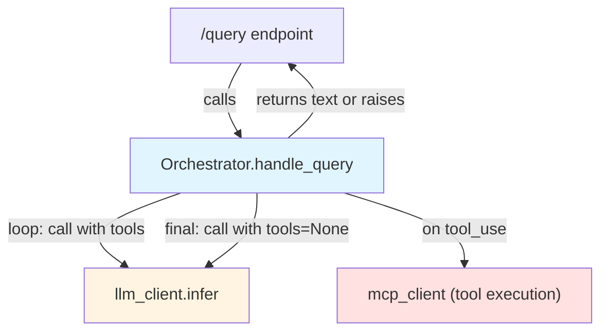
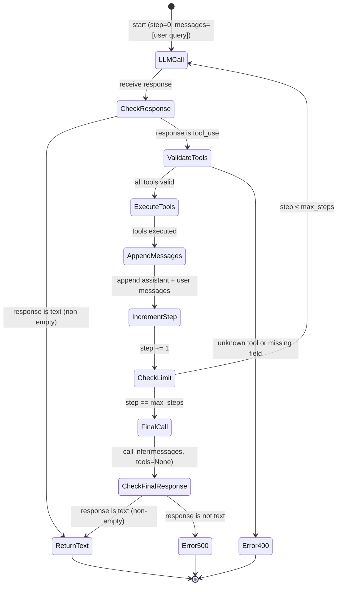

# High-Level Design — PER-56

**made from:** requirements.md  
**source:** Winston (system architect)  
**altitude:** feature

---

## Executive summary

This design replaces the orchestrator's single tool round with a **bounded agent loop**: the LLM may call tools, observe results, and call additional tools until it produces a text answer or exhausts a configurable step budget (`max_steps`). The loop preserves the existing tool-execution contract (validation, timeout, error codes) and message-history structure while removing the old `tools=None` synthesis call and its "synthesis loop detected" guard. The step limit acts as a safety rail: when reached, one final `tools=None` call attempts to force an answer; failure to produce text raises `RuntimeError`.

---

## Scope

### In scope

- Bounded multi-step loop in `Orchestrator.handle_query` (max `max_steps` tool rounds).
- New constructor parameter `max_steps: int = 5` on `Orchestrator`.
- Environment variable `AGENT_MAX_STEPS` parsed by `run_server` and passed to `Orchestrator`.
- INFO-level logging for each step (step number, tool names).
- Final `tools=None` fallback when `max_steps` is reached, with `RuntimeError` if no text answer.
- Existing `ValueError` handling (unknown tool, missing field) unchanged; HTTP status codes unchanged.
- Test expansion: direct text, two-step chain, step-limit scenarios, unknown-tool-on-step-2, `AGENT_MAX_STEPS` parsing.
- README update: environment variable table and one-sentence capability description.

### Out of scope

- Conversation memory across `/query` requests.
- Streaming responses.
- Any changes to `mcp_client.py` or the MCP server.

---

## Design paradigm

**Stateless request handler with bounded iteration.** The orchestrator remains a per-request handler with no persistent conversation state. The multi-step loop is a **tail-recursive iteration** over the message list, bounded by `max_steps` to prevent unbounded LLM calls. The loop invariant is: *the message list always ends with the most recent LLM response (tool-use assistant message) and its corresponding tool-result user message (if tools were executed) before the next LLM call*. The existing synchronous, single-threaded, exception-based error model is preserved.

---

## Architecture decisions

### AD-1: Bounded agent loop with message-list evolution

**Binds:** `Orchestrator.handle_query` implements a loop: call `llm_client.infer(messages, tools=tools)` → if `tool_use`, validate/execute tools, append assistant message + user result message, loop; if `text`, return text. One step = one `tool_use` response. Tools stay available (`tools=tools`) on every step until the limit.

**Prevents:** Two implementations built independently could diverge on (a) whether tools are still offered after the first round, (b) when to stop the loop (text answer vs step limit), (c) message-list structure after tool execution.

**Rule:** Loop structure:

```
messages = [user query]
step = 0
while step < max_steps:
    response = llm_client.infer(messages, tools=tools)
    if response is text (non-empty):
        return text
    if response is tool_use:
        validate and execute each tool call (existing logic)
        append assistant tool-use message to messages
        append user tool-result message to messages
        step += 1
        log step number and tool names at INFO
        continue
# step == max_steps
response = llm_client.infer(messages, tools=None)
if response is text (non-empty):
    return text
raise RuntimeError("agent exceeded max_steps without an answer")
```

Message-list shape after one tool round (step 1):

```
[
  {"role": "user", "content": "<original query>"},
  {"role": "assistant", "content": [{"type": "tool_use", "id": "...", "name": "...", "input": {...}}]},
  {"role": "user", "content": [{"type": "tool_result", "tool_use_id": "...", "content": "..."}]}
]
```

After two rounds, two more messages are appended (second assistant tool-use, second user tool-result), and so on.

**[ADOPTED]** — existing codebase already appends assistant and user messages after tool execution; this extends that pattern into a loop.

---

### AD-2: Step limit and final fallback

**Binds:** Constructor parameter `max_steps: int = 5` on `Orchestrator`. When `step == max_steps`, make one final `llm_client.infer(messages, tools=None)` call. If that returns non-empty text, return it. If not (tool_use or empty text), raise `RuntimeError("agent exceeded max_steps without an answer")`.

**Prevents:** Unbounded LLM calls (cost, latency). Two implementations could diverge on whether to attempt a final answer when the limit is hit vs immediately fail.

**Rule:** The final `tools=None` call *asks* the LLM to answer with the accumulated context; it does not *guarantee* an answer. The step counter starts at 0; the first `tool_use` response increments it to 1. A `max_steps=2` allows up to two tool rounds (steps 1 and 2), then the final fallback call. A query that produces a direct text answer (no tools) consumes zero steps.

**[ADOPTED]** — step limit is the new safety mechanism replacing the old synthesis-loop guard.

---

### AD-3: Environment variable parsing and default

**Binds:** `run_server` reads `AGENT_MAX_STEPS` from `os.environ`. If the value is a valid positive integer, pass it to `Orchestrator(max_steps=<value>)`. Otherwise log a warning (`logger.warning`) and use `5`. Valid = string that parses as `int` and `> 0`.

**Prevents:** Invalid config crashing the server vs silently using a default. Two implementations could diverge on what "invalid" means (non-integer, zero, negative, empty) or whether to warn.

**Rule:**

```python
try:
    raw = os.environ.get("AGENT_MAX_STEPS", "")
    if raw:
        max_steps = int(raw)
        if max_steps <= 0:
            raise ValueError
    else:
        max_steps = 5  # default when env var is absent
except (ValueError, TypeError):
    logger.warning("Invalid AGENT_MAX_STEPS, using default 5")
    max_steps = 5
```

**[ADOPTED]** — existing codebase does not parse config from env vars yet; this establishes the pattern (parse, validate, warn-and-default).

---

### AD-4: Error handling unchanged

**Binds:** `ValueError` (unknown tool, missing required field) raised during tool validation/execution → HTTP 400. All other exceptions (including `RuntimeError` from step-limit exhaustion) → HTTP 500. Non-empty text answer → HTTP 200.

**Prevents:** Changing the error-code contract for existing callers vs new step-limit errors getting a different code.

**Rule:** The existing `try/except` structure in the HTTP handler (`/query` endpoint) already maps `ValueError` → 400 and catches all other exceptions → 500. No changes needed; the new `RuntimeError` naturally falls into the 500 path.

**[ADOPTED]** — existing error-handling code is unchanged; new error types map to existing status codes.

---

### AD-5: Logging per step

**Binds:** After each tool round completes, log at `logger.info` level: step number (1-indexed for readability) and the list of tool names called in that round (extracted from the `tool_use` response).

**Prevents:** Silent tool execution making debugging multi-step queries hard. Two implementations could diverge on log level (DEBUG vs INFO), content (tool names vs full tool calls), or timing (before vs after execution).

**Rule:**

```python
logger.info(f"Step {step}: executed tools {tool_names}")
```

Where `tool_names` is `[call["name"] for call in tool_use_content]` (the list of `name` fields from the assistant message's tool-use content). Log *after* execution completes, so the log confirms the tools ran.

**[ADOPTED]** — logging at INFO matches the existing log level for user-query entry; tool names (not full input) are sufficient for tracing without leaking sensitive data.

---

### AD-6: Backward compatibility for direct-text answers

**Binds:** A query that produces a direct text answer (no tool use) on the first LLM call incurs exactly one `infer` call, zero tool executions, and zero steps. Behavior identical to today.

**Prevents:** Performance regression (extra calls) for the common no-tool case.

**Rule:** The loop's first iteration checks the response type before incrementing `step`. A `text` response returns immediately, never entering the loop body past the type check. The step counter stays 0 for direct-text answers.

**[ADOPTED]** — existing tests for direct-text answers continue to pass with no changes.

---

## System structure

### Component view



**Orchestrator** owns the loop. **LLM client** is called repeatedly with the evolving message list. **MCP client** is called once per tool round (after validation, before appending tool results). HTTP layer is unchanged except for passing `max_steps` from env var.

---

### Loop state machine



**Key transitions:**

- `CheckResponse → ReturnText`: exits loop immediately on text answer.
- `CheckLimit → LLMCall`: continues loop while steps remain.
- `CheckLimit → FinalCall`: step limit reached, attempt final answer.
- `CheckFinalResponse → Error500`: final call failed to produce text, raise `RuntimeError`.

---

### Message-list evolution example

Initial state (step 0):

```json
[
  {"role": "user", "content": "Who is EMP-001's manager and what are that manager's sales orders?"}
]
```

After step 1 (tool_use: `get_employee`, result: `{"manager_id": "EMP-042"}`):

```json
[
  {"role": "user", "content": "Who is EMP-001's manager and what are that manager's sales orders?"},
  {"role": "assistant", "content": [{"type": "tool_use", "id": "toolu_01", "name": "get_employee", "input": {"employee_id": "EMP-001"}}]},
  {"role": "user", "content": [{"type": "tool_result", "tool_use_id": "toolu_01", "content": "{\"manager_id\": \"EMP-042\"}"}]}
]
```

After step 2 (tool_use: `get_sales_orders`, result: `[{"order_id": "SO-123"}]`):

```json
[
  {"role": "user", "content": "Who is EMP-001's manager and what are that manager's sales orders?"},
  {"role": "assistant", "content": [{"type": "tool_use", "id": "toolu_01", "name": "get_employee", "input": {"employee_id": "EMP-001"}}]},
  {"role": "user", "content": [{"type": "tool_result", "tool_use_id": "toolu_01", "content": "{\"manager_id\": \"EMP-042\"}"}]},
  {"role": "assistant", "content": [{"type": "tool_use", "id": "toolu_02", "name": "get_sales_orders", "input": {"employee_id": "EMP-042"}}]},
  {"role": "user", "content": [{"type": "tool_result", "tool_use_id": "toolu_02", "content": "[{\"order_id\": \"SO-123\"}]"}]}
]
```

Step 3 (LLM call): returns text `"EMP-001's manager is EMP-042, who has one sales order: SO-123."` → orchestrator returns this text.

If step 3 had been `tool_use` again and `max_steps=2`, the orchestrator would make a final call with `tools=None` on the 5-message list above.

---

## Data contracts

### Constructor signature (Orchestrator)

```python
class Orchestrator:
    def __init__(
        self,
        llm_client: LLMClient,
        mcp_client: MCPClient,
        tools: list[dict],
        max_steps: int = 5
    ):
        ...
```

**New parameter:** `max_steps: int = 5` — maximum tool rounds before forcing a final answer.

---

### Environment variable

**Name:** `AGENT_MAX_STEPS`  
**Type:** string (parsed as positive integer)  
**Default:** `"5"` (used when env var is absent or invalid)  
**Valid values:** `"1"`, `"2"`, ..., `"99"` (any positive integer string)  
**Invalid values:** `""`, `"0"`, `"-1"`, `"foo"`, `"3.5"` → log warning, use default `5`.

---

### Log message format

```
INFO: Step 1: executed tools ['get_employee']
INFO: Step 2: executed tools ['get_sales_orders']
```

One log line per tool round, after tools execute. Tool names are the `name` field from each tool-use call, in the order returned by the LLM.

---

### Error messages

- **Unknown tool (existing):** `ValueError: unknown tool <name>` → HTTP 400.
- **Missing required field (existing):** `ValueError: missing required field <field> for tool <name>` → HTTP 400.
- **Step limit exceeded (new):** `RuntimeError("agent exceeded max_steps without an answer")` → HTTP 500.
- **Invalid AGENT_MAX_STEPS (new):** `WARNING: Invalid AGENT_MAX_STEPS, using default 5` (logged, not raised).

---

## Risks and mitigations

### RISK-1: LLM never converges to a text answer

**Likelihood:** Medium (model may loop indefinitely on certain queries)  
**Impact:** High (user gets no answer, wasted API calls)  
**Mitigation (implemented):** `max_steps` hard limit + final `tools=None` call forces the model to attempt an answer. If it still fails, `RuntimeError` with clear message tells the user the query could not be answered.  
**Residual risk:** The final answer may be low-quality ("I don't have enough information") vs a crisp "exceeded step limit" user-facing message. Acceptance: low-quality answer is better than a crash; the step-limit error is for unrecoverable cases.

---

### RISK-2: Step limit too low for complex queries

**Likelihood:** Low (default 5 is generous for typical two- or three-hop queries)  
**Impact:** Medium (query fails when it could have succeeded with one more step)  
**Mitigation (implemented):** `AGENT_MAX_STEPS` env var allows tuning per deployment. README documents the parameter.  
**Residual risk:** Users may not discover the env var. Acceptance: default 5 is a reasonable balance; production deployments can tune after observing real query patterns.

---

### RISK-3: Tool execution timeout unchanged (10s per tool)

**Likelihood:** Low (existing 10s timeout has been sufficient)  
**Impact:** Low (multi-step query may hit timeout on one tool, failing the whole query)  
**Mitigation (deferred):** Timeout is per-tool, not per-query. A five-step query can run up to 50s of tool time (plus LLM latency). If this becomes a problem, future work can add a per-query timeout or make the per-tool timeout configurable.  
**Residual risk:** Accepted; no change needed for this feature.

---

### RISK-4: Message list grows unbounded in pathological cases

**Likelihood:** Very Low (bounded by `max_steps`)  
**Impact:** Low (memory usage, LLM context window)  
**Mitigation (implicit):** Each step adds exactly two messages (assistant + user). Max message count = `1 (user query) + 2 * max_steps + 1 (final call) = 2 * max_steps + 2`. At default `max_steps=5`, that's 12 messages. Well within typical context windows (100k+ tokens).  
**Residual risk:** Accepted; no explicit truncation needed.

---

## Open questions

None.

---

## Deferred decisions

- **Per-query timeout:** Not implemented. The per-tool 10s timeout is reused. Future work can add a query-level timeout if needed.
- **Conversation memory across requests:** Out of scope. Each `/query` request is stateless.
- **Streaming responses:** Out of scope. The orchestrator returns the final text synchronously.
- **Adaptive step limit:** Not implemented. `max_steps` is fixed per deployment. Future work could let the LLM signal "I need more steps" vs "I'm stuck" to adjust the limit dynamically.

---

## Dependencies

- **Existing:** `llm_client.infer(messages, tools)` returns `{"type": "text"|"tool_use", ...}`.
- **Existing:** `mcp_client` executes tools and returns results (unchanged).
- **Existing:** `Orchestrator` validates tool calls and appends messages (logic reused in loop).
- **New:** `run_server` parses `AGENT_MAX_STEPS` and passes `max_steps` to `Orchestrator` constructor.

No new external dependencies. No changes to MCP client or server.

---

## Testing strategy

### Unit tests (test_orchestrator.py)

Mock `llm_client.infer` and `mcp_client` to return canned responses. Assert on call counts, message-list contents, and return values.

**Test cases (map to ACs):**

1. **AC-1 (direct text):** Mock `infer` returns text on first call → assert one `infer` call, zero `mcp_client` calls, text returned.
2. **AC-2 (two-step chain):** Mock `infer` returns tool_use on first call, text on second → assert two `infer` calls, one `mcp_client` call, second call's `messages` includes first tool result, text returned.
3. **AC-3 (step limit with answer):** `max_steps=2`, mock `infer` returns tool_use twice, text on third (final `tools=None`) call → assert two tool rounds, one final call, text returned.
4. **AC-4 (step limit without answer):** `max_steps=2`, mock `infer` returns tool_use on all three calls → assert two tool rounds, one final call, `RuntimeError` raised.
5. **AC-5 (unknown tool on step 2):** Mock `infer` returns valid tool_use on first call, unknown tool on second → assert first tool executes, `ValueError` raised before third LLM call.

### Unit tests (test_http_server.py)

Mock `os.environ` to test `AGENT_MAX_STEPS` parsing.

**Test cases (map to AC-6):**

1. Valid value `"3"` → `Orchestrator` instantiated with `max_steps=3`.
2. Invalid values `"foo"`, `"-1"`, `""` → warning logged, `Orchestrator` instantiated with `max_steps=5`.

### Integration / manual tests

- **AC-7:** Run `pytest` and confirm old "synthesis loop detected" test is removed or updated.
- **AC-8:** Review README diff for `AGENT_MAX_STEPS` in env var table and capability description.

No changes to `test_mcp_client.py` or MCP server tests (MCP layer unchanged).

---

## README updates

### Environment variables table

Add row:

| Variable | Description | Default |
|----------|-------------|---------|
| `AGENT_MAX_STEPS` | Maximum tool-use steps before forcing a final answer | `5` |

### Capability description (new section or existing "Features")

> The orchestrator supports multi-step tool use, allowing the LLM to call tools, see results, and call additional tools until it produces an answer or reaches the step limit.

---

## Verification checklist

- [ ] All unit tests in `test_orchestrator.py` pass (AC-1 through AC-5).
- [ ] All unit tests in `test_http_server.py` pass (AC-6).
- [ ] Old synthesis-loop test removed or updated (AC-7).
- [ ] README updated with `AGENT_MAX_STEPS` and capability description (AC-8).
- [ ] `python -m pytest -q` exits 0 (all tests pass).
- [ ] Manual review: HTTP status codes unchanged (400 for `ValueError`, 500 for other errors, 200 for success).
- [ ] Manual review: no changes to `mcp_client.py` or MCP server.
