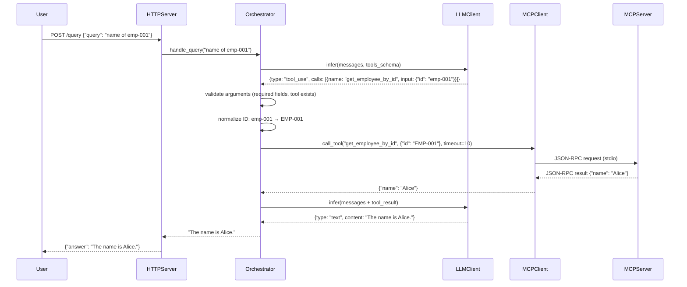

# High-Level Design: HTTP Agent with MCP Tool Calling

**Ticket**: [agent] Agent which can directly answer or via MCP tools  
**Date**: 2025-01-21  
**Altitude**: Feature  
**Status**: Draft

---

## 1. Overview

An HTTP service exposing a single `POST /query` endpoint that accepts natural-language questions and returns answers. The agent uses an LLM to decide whether to respond directly or invoke MCP tools over stdio. MCP tools fetch data from the PER-5 GraphQL service via the PER-6 MCP server.

**Key Outcomes**:
- Natural-language queries return useful text answers in format `{"answer": "<text>"}`.
- LLM tool-calling enables data lookup when needed; direct answers when not.
- All four MCP tools (`list_sales_order`, `list_employees`, `get_sales_order_by_id`, `get_employee_by_id`) are callable over stdio.
- Example query `"what is the name of employee with emp-001"` returns employee name via tool path with ID normalization to `EMP-001`.

---

## 2. Components

### 2.1 HTTP Server (`app/agent/http_server.py`)
**Responsibility**: Accept HTTP requests, route to query handler, return JSON responses.

**Contracts**:
- Endpoint: `POST /query`
- Request body: `{"query": "<natural language>"}`
- Response: HTTP 200 with `{"answer": "<text>"}` on success
- Response: HTTP 400 with `{"error": "<validation message>"}` on malformed request or missing field
- Response: HTTP 500 with `{"error": "internal error"}` on internal failure
- Endpoint: `GET /health`
- Health response: HTTP 200 with `{"status": "ok", "mcp_alive": true}` when MCP subprocess alive
- Health response: HTTP 503 with `{"status": "degraded", "mcp_alive": false}` when MCP crashed

**Outcomes**:
- Valid requests route to agent orchestrator.
- Malformed JSON or missing `query` field returns 400.
- Unhandled exceptions return 500 with logged error trace.
- Health check validates MCP subprocess status.

**Dependencies**: Agent Orchestrator

---

### 2.2 Agent Orchestrator (`app/agent/orchestrator.py`)
**Responsibility**: Coordinate LLM inference and MCP tool invocation.

**Contracts**:
- Input: user query string
- Output: answer string
- Raises exceptions on LLM or MCP failures (caught by HTTP server → 500)
- Raises `ValueError` on tool argument validation failures (caught by HTTP server → 400)
- Raises `RuntimeError` on synthesis loop detection (caught by HTTP server → 500)

**Outcomes**:
- Constructs LLM prompt with user query and available MCP tool schemas.
- Parses LLM response:
  - **Direct answer**: returns LLM text as-is.
  - **Tool call(s)**: validates arguments against schema (required fields present, tool name exists), normalizes IDs to uppercase, invokes MCP client, collects results, re-prompts LLM for synthesis.
- Limits to 2 LLM calls total (initial + synthesis); detects and errors on synthesis loops (LLM requests tools on synthesis step).
- Normalizes all `id` fields to uppercase before tool invocation (e.g., `emp-001` → `EMP-001`).

**Dependencies**: LLM Client, MCP Client

---

### 2.3 LLM Client (`app/agent/llm_client.py`)
**Responsibility**: Call Anthropic API for completion/tool-calling inference.

**Contracts**:
- Input: messages array (system prompt + user query + optional tool results), available tools schema
- Output: either `{"type": "text", "content": "<answer>"}` or `{"type": "tool_use", "calls": [{"id": "<id>", "name": "<name>", "input": {...}}, ...]}`
- Raises exceptions on API errors

**Outcomes**:
- Supports Anthropic Messages API tool-use format.
- Returns parsed decision for orchestrator to act on.
- Configured via `ANTHROPIC_API_KEY` and optional `ANTHROPIC_BASE_URL` env vars.

**Dependencies**: External Anthropic API

---

### 2.4 MCP Client (`app/agent/mcp_client.py`)
**Responsibility**: Launch MCP stdio server, discover tools, invoke tool calls.

**Contracts**:
- Startup: spawns `python -m mcp.server` subprocess, sends MCP handshake, receives tool list
- Input: tool name string, arguments dict, optional timeout (default 10s)
- Output: tool result dict (success data) or raises exception on error/timeout
- Shutdown: gracefully terminates subprocess

**Outcomes**:
- On startup, lists available tools and validates all four required tools present.
- Translates orchestrator tool call into MCP JSON-RPC request over stdin/stdout.
- Returns parsed result or raises `TimeoutError` after 10s, or `RuntimeError` on tool error.
- Subprocess configured with `GRAPHQL_ENDPOINT` in environment.

**Dependencies**: PER-6 MCP server (stdio), PER-5 GraphQL service (via MCP server)

---

## 3. Data Flow



---

## 4. Architectural Decisions

### AD-1: Use LLM Tool Calling (Not Keyword Routing)
**Binds**: Natural-language queries must be interpreted by LLM for tool selection.  
**Prevents**: Brittle keyword-based dispatch that breaks on paraphrase or multi-step questions.  
**Rule**: Orchestrator sends user query + tool schemas to LLM; LLM decides tool usage. No hardcoded keyword patterns.  
**Status**: [ADOPTED] (ticket requirement)

### AD-2: MCP via Stdio Subprocess
**Binds**: MCP client spawns `python -m mcp.server` from PER-6 repo and communicates over stdin/stdout using JSON-RPC.  
**Prevents**: Dependency on HTTP MCP or FastMCP (out of scope per ticket).  
**Rule**: MCP client manages subprocess lifecycle (start on agent init, terminate on shutdown). Subprocess environment includes `GRAPHQL_ENDPOINT`.  
**Status**: [ADOPTED] (ticket dependency constraint)

### AD-3: ID Normalization in Orchestrator
**Binds**: Orchestrator normalizes all `id` fields to uppercase before invoking MCP tools.  
**Prevents**: Tool failures when user input case does not match GraphQL mock data format.  
**Rule**: Apply `.upper()` transformation to any argument key named `id` extracted from LLM tool calls. This handles the example `emp-001` → `EMP-001` and generalizes to all ID fields.  
**Status**: [ADOPTED] (ticket AC5)

### AD-4: Multi-Step Tool Calling with Synthesis Loop Detection
**Binds**: Orchestrator supports iterative LLM inference: if LLM returns tool calls, execute them, then re-prompt LLM with results to synthesize final answer. Limit to 2 LLM calls total.  
**Prevents**: Incomplete answers when LLM needs tool data to formulate response. Prevents infinite loops when LLM hallucinates tool requests on synthesis step.  
**Rule**: After tool execution, append tool results to conversation messages and call LLM again without tools. If LLM requests tools on synthesis step, raise `RuntimeError` to prevent loops.  
**Status**: [ADOPTED] (ensures useful answers per ticket goal, mitigates synthesis loop risk)

### AD-5: Comprehensive Error Handling with Argument Validation
**Binds**: LLM API errors, MCP tool errors, argument validation errors (missing required fields, unknown tool names), synthesis loop detection, and malformed requests each return distinct HTTP status codes and logged traces.  
**Prevents**: Silent failures, generic 500 responses that hide root cause, tool invocations with invalid arguments.  
**Rule**:
- Malformed JSON or missing `query`: 400 with `{"error": "<validation message>"}`
- Argument validation failures (missing required field, unknown tool): 400 with error message
- LLM/MCP exceptions (API error, tool execution error, timeout), synthesis loop `RuntimeError`: 500 with `{"error": "internal error"}`, full trace logged
- MCP subprocess crash during startup: agent fails to start (logged), no partial availability
- MCP subprocess crash after startup: health check returns 503, requests return 500  
**Status**: [ADOPTED]

---

## 5. Technology Choices

### 5.1 Web Framework
**Choice**: Flask 3.1.0  
**Rationale**: Lightweight, minimal dependencies, single endpoint use case. FastAPI considered but overkill for this scope.  
**Verification**: Flask 3.1.x is current stable (verified 2025-01-21).

### 5.2 LLM Provider
**Choice**: Anthropic Claude via Messages API with tool use  
**Rationale**: Ticket specifies existing Anthropic gateway pattern from ADLC. Tool-use format is stable and well-documented.  
**Verification**: `anthropic` SDK 0.18.0 supports tool use (verified 2025-01-21).

### 5.3 MCP Protocol
**Choice**: JSON-RPC over stdio, using subprocess management  
**Rationale**: PER-6 dependency constraint. No HTTP transport allowed.  
**Verification**: MCP protocol version `2024-11-05` used in handshake (latest spec).

### 5.4 Testing
**Choice**: `pytest` with mocked LLM/MCP responses + manual verification script  
**Rationale**: Ticket AC6 requires 21 unit tests (6 HTTP server, 3 LLM client, 4 MCP client, 8 orchestrator), 1 integration test with mocked services, and documented manual verification against real PER-5/PER-6 services.  
**Verification**: `pytest` 8.x is current (verified 2025-01-21). `unittest.mock` is stdlib.

---

## 6. Risks & Mitigations

| Risk | Impact | Mitigation |
|------|--------|------------|
| LLM hallucinates tool calls with invalid arguments | High (400/500 errors, poor UX) | Validate tool call arguments against schema before invoking MCP (check required fields, verify tool name exists). Return 400 on validation failure. Log hallucinations for LLM tuning. Implemented in orchestrator (AD-5). |
| MCP subprocess hangs or crashes | High (agent unavailable) | Implement subprocess health check on startup (verify handshake succeeds). Add 10s timeout for MCP JSON-RPC requests. Health endpoint reports subprocess status. Log crashes with full trace. Implemented in MCP client. |
| GraphQL service (PER-5) is unreachable | High (all tool calls fail) | MCP server will error; agent returns 500. Document dependency in README. Health check validates MCP subprocess alive (not GraphQL reachability). |
| LLM cost exceeds budget for high query volume | Medium (cost overrun) | Out of scope for this ticket. Future: rate-limit `/query` endpoint (e.g., 10 req/min per IP). Log token usage per request. Monitor via Anthropic dashboard. |
| User queries expose PII in logs | Medium (compliance risk) | Redact full `query` content in access logs (log only first 50 chars + `...` or query length). Full query in debug logs only. Document retention policy in deployment guide. |
| Synthesis loop (LLM requests tools again) | Medium (infinite loop, latency) | Detect tool requests on synthesis step, raise `RuntimeError`. Limit to 2 LLM calls total. Implemented in orchestrator (AD-4). |
| Timeout too short for complex queries | Low (false timeouts) | 10s timeout is configurable. Monitor P99 latency, adjust if needed. Default conservative for stdio subprocess. |

---

## 7. Testing Strategy

### Unit Tests (21 total)

**HTTP Server** (`tests/test_http_server.py`, 6 tests):
1. Valid POST request to `/query` returns 200 with JSON `{"answer": "<text>"}`
2. Malformed JSON to `/query` returns 400
3. Valid JSON without `query` field returns 400
4. Internal error (mocked orchestrator exception) returns 500
5. Health check with MCP subprocess alive returns 200 with `{"status": "ok", "mcp_alive": true}`
6. Health check with MCP subprocess crashed returns 503 with `{"status": "degraded", "mcp_alive": false}`

**LLM Client** (`tests/test_llm_client.py`, 3 tests):
1. Direct answer parsing from mocked Anthropic API response
2. Tool call parsing from mocked Anthropic API response
3. API error propagation (mocked API raises exception → client propagates)

**MCP Client** (`tests/test_mcp_client.py`, 4 tests):
1. Successful subprocess handshake and tool discovery (all four tools present)
2. Handshake failure handling (mocked subprocess returns error → raises `RuntimeError`)
3. Graceful shutdown (subprocess terminates cleanly)
4. Tool call timeout after 10s (mocked subprocess does not respond → raises `TimeoutError`)

**Orchestrator** (`tests/test_orchestrator.py`, 8 tests):
1. Direct answer path (mocked LLM returns text → no MCP call, 1 LLM call)
2. Tool call success with employee lookup and synthesis (mocked LLM returns tool call → mocked MCP returns data → mocked LLM synthesis → 2 LLM calls, 1 MCP call)
3. MCP tool error propagation (mocked MCP raises exception → orchestrator propagates)
4. LLM call count verification (exactly 2 on tool path, exactly 1 on direct path)
5. ID normalization (`emp-001` → `EMP-001` before MCP invocation)
6. Argument validation: missing required field raises `ValueError` (caught by HTTP server → 400)
7. Argument validation: unknown tool name raises `ValueError` (caught by HTTP server → 400)
8. Synthesis loop detection (mocked LLM requests tools on synthesis step → raises `RuntimeError`)

**Total Unit Tests**: 6 + 3 + 4 + 8 = 21

---

### Integration Test (1 test)

**End-to-End** (`tests/test_integration.py`):
- Start Flask app with mocked LLM client (returns canned tool call for query containing `"emp-001"`, returns canned synthesis text `"The name is Alice."`)
- Start Flask app with mocked MCP client (returns `{"name": "Alice", "id": "EMP-001"}` for `get_employee_by_id`)
- Send `POST /query` with body `{"query": "what is the name of employee with emp-001"}`
- Assert: response status 200, response body `{"answer": "The name is Alice."}`, LLM called exactly 2 times, MCP called exactly 1 time with normalized ID `EMP-001`

---

### Manual Verification Script (1 artifact)

**`tests/manual_verification.md`**:

Document steps to test against real PER-5 GraphQL service and PER-6 MCP server.

**Test Cases**:
1. `"hello"` → direct answer (verifies AC2)
2. `"what is the name of employee with emp-001"` → employee name via tool path (verifies AC3, AC5)
3. `"list all employees"` → list via `list_employees` tool (verifies AC4)
4. `"get sales order ord-001"` → order details via `get_sales_order_by_id` tool (verifies AC4)
5. `GET /health` → `{"status": "ok", "mcp_alive": true}` (verifies health endpoint)

**Includes**: Setup instructions (environment variables, PER-5/PER-6 service startup), expected outputs per test case, troubleshooting steps (MCP subprocess not starting, GraphQL connection refused, LLM API errors, incorrect answers, timing expectations).

**Total Verification Artifacts**: 21 unit tests + 1 integration test + 1 manual script = AC6 satisfied.

---

## 8. Deployment & Configuration

### Environment Variables
```bash
ANTHROPIC_API_KEY=<key>               # Required: Anthropic API key
ANTHROPIC_BASE_URL=<gateway URL>       # Optional: defaults to https://api.anthropic.com
GRAPHQL_ENDPOINT=<url>                 # Required: e.g., http://localhost:4000/graphql
MCP_SERVER_COMMAND=<command>           # Optional: defaults to "python -m mcp.server"
MCP_SERVER_WORKING_DIR=<path>          # Required: PER-6 repo path
FLASK_HOST=<host>                      # Optional: defaults to 0.0.0.0
FLASK_PORT=<port>                      # Optional: defaults to 5000
LOG_LEVEL=<level>                      # Optional: defaults to INFO
```

### Startup Sequence
1. Load environment variables; validate required vars present.
2. Initialize LLM client with API key and base URL.
3. Initialize MCP client with server command, working dir, subprocess env (including `GRAPHQL_ENDPOINT`).
4. Start MCP subprocess, perform handshake, fetch and validate tool list (all four tools present).
5. Initialize orchestrator with LLM and MCP clients.
6. Create Flask app with orchestrator.
7. Start Flask HTTP server (blocking).
8. Log `Agent ready, listening on {host}:{port}, tools: {tool_names}`.

### Shutdown
1. Flask receives SIGTERM.
2. Call `mcp_client.shutdown()` to terminate subprocess gracefully (send EOF to stdin, wait 5s, SIGKILL if needed).
3. Exit.

---

## 9. Future Enhancements (Deferred)

- **Streaming responses**: Return partial answers as LLM generates tokens (requires SSE or WebSocket, out of scope).
- **Multi-turn conversations**: Maintain session state across requests (requires session store, auth).
- **Tool result caching**: Cache MCP tool results per ID to reduce GraphQL load (requires cache layer, TTL policy).
- **Structured output**: Return not just text but structured JSON with tool call metadata (requires API contract change).
- **Observability**: Trace LLM/MCP calls with OpenTelemetry (requires instrumentation).
- **MCP auto-restart**: Restart MCP subprocess on crash instead of failing requests (requires retry logic, health monitoring).
- **LLM timeout**: Add configurable timeout to LLM client `infer()` method (currently relies on SDK default).
- **Rate limiting**: Add per-IP or global rate limits on `/query` endpoint (requires middleware).

---

## 10. Acceptance Criteria Verification

| AC | HLD Coverage |
|----|--------------|
| AC1: HTTP endpoint returns 200 + JSON | §2.1 HTTP Server contract (request/response format), §4 AD-5 error handling, §7 testing (6 HTTP server tests including valid request, malformed JSON, missing field, internal error) |
| AC2: Direct answer without tool | §2.2 Orchestrator outcomes (direct text path), §4 AD-1 (LLM decides), §7 testing (orchestrator test 1: direct answer path with 1 LLM call, manual case 1: `"hello"`) |
| AC3: Tool call for employee lookup | §2.2 Orchestrator outcomes (tool call path), §3 data flow diagram, §4 AD-3 (ID normalization), §7 testing (orchestrator test 2: tool call success with synthesis, manual case 2: employee name via tool path) |
| AC4: All four MCP tools available | §2.4 MCP Client startup outcome (validate four tools), §7 testing (MCP client test 1: successful handshake and tool discovery, manual cases 3–4: list employees, get sales order) |
| AC5: ID normalization | §4 AD-3 explicit rule (`.upper()` on `id` fields), §2.2 orchestrator responsibility, §3 data flow (normalization step), §7 testing (orchestrator test 5: ID normalization `emp-001` → `EMP-001`, manual case 2: employee lookup with lowercase ID) |
| AC6: Basic tests | §7 Testing Strategy (21 unit + 1 integration + manual script), detailed test file breakdown with exact counts (6 HTTP server + 3 LLM client + 4 MCP client + 8 orchestrator = 21 unit tests), each orchestrator test explicitly listed including argument validation (tests 6–7), synthesis loop detection (test 8), and ID normalization (test 5) |

---

**End of HLD**
